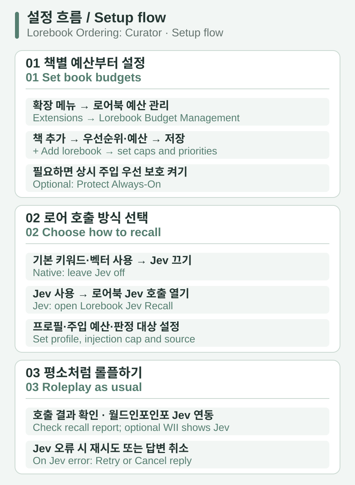
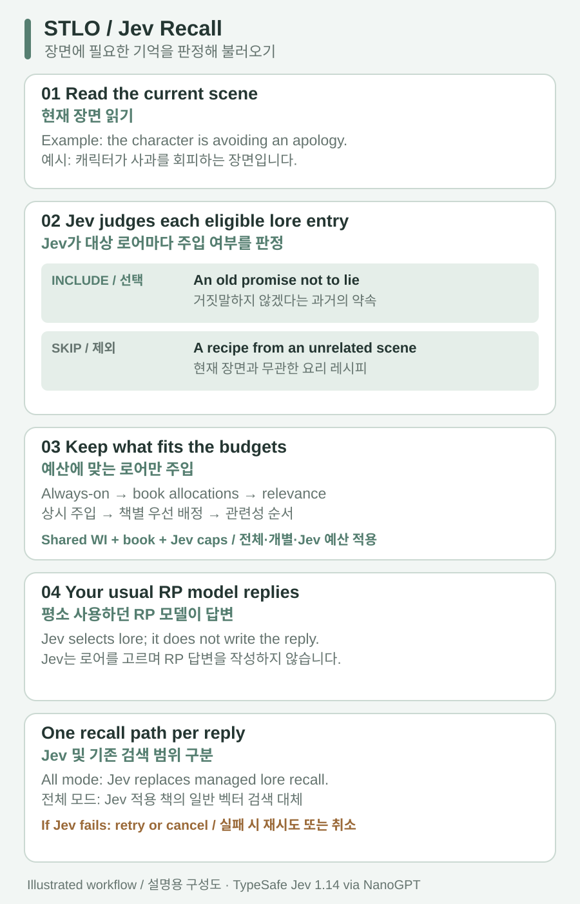
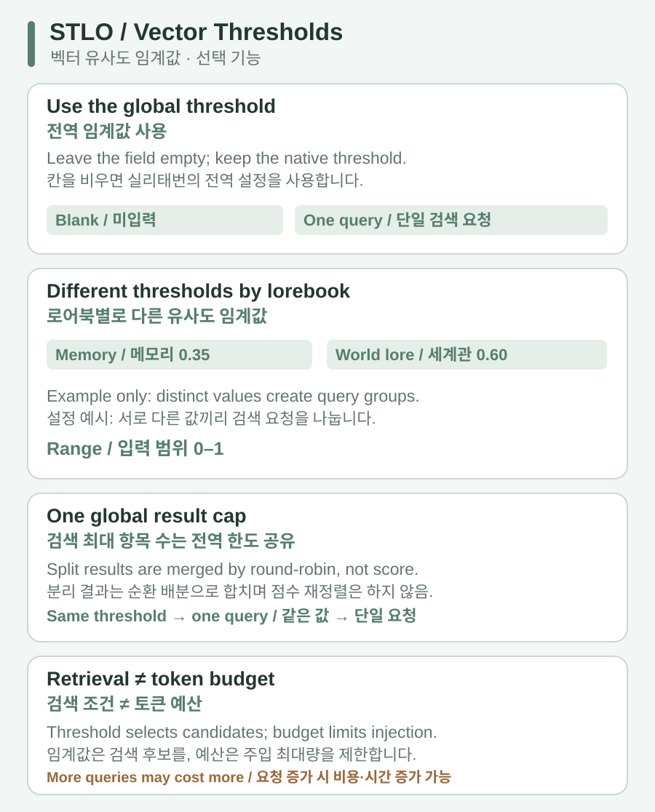

# 📚 ST Lorebook Ordering (STLO) — Ambasa Fork

**Scene-aware lore recall with Jev, plus lorebook priorities, token budgets, always-on protection, and optional per-lorebook vector thresholds for SillyTavern.**

This is a fork of [ST Lorebook Ordering by aikohanasaki](https://github.com/aikohanasaki/SillyTavern-LorebookOrdering), based on upstream v2.2.4. The original extension provides the core priority, budget, order adjustment, random trimming, and group-chat features. This fork retains those features and adds Jev-based lore selection, always-on protection, and book-specific vector settings. Many thanks to aikohanasaki for the original design and implementation.

[English](#-installation-and-first-steps) · [한국어](#-stlo-포크--로어북-예산-관리) · [한국어 Notion 사용 설명서](https://app.notion.com/p/422a96b06fd481c3afd5c3c90288ba3a) · [Original STLO](https://github.com/aikohanasaki/SillyTavern-LorebookOrdering)

## Who is this for?

- Long-running roleplays where old promises and events are hard to recall, but irrelevant lore often appears.
- Players with several lorebooks (character details, worldbuilding, memories) who want to control their relative priority and token usage.
- Players who keep recent memories or essential settings always on and want to protect them from being crowded out.
- Vector users who want different similarity thresholds for different books.

Jev is optional. You can use this fork solely for book-level priority, budgets and always-on protection.

## 📸 Settings Preview


The diagrams in this README are illustrated guides based on the fork's settings, not screenshots. The bilingual labels explain the controls; the current interface retains Korean-only labels for some fork-specific controls.

## 📥 Installation and First Steps

1. Back up your lorebooks and settings. If you have upstream STLO installed, disable or remove it before enabling this fork. Do not run both at the same time.
2. In SillyTavern, open **Extensions → Install extension** and paste:

   ```
   https://github.com/AmbasaS2/SillyTavern-LorebookOrdering
   ```

3. Install and reload SillyTavern. Use a recent SillyTavern version with the `WORLDINFO_SCAN_DONE` event (e.g. the 1.18 series) for Jev and per-lorebook budget trimming.
4. Open **Extensions menu → 로어북 예산 관리 (Lorebook Budget Management)**, edit one or more lorebooks in collapsible cards, then save them together. For character-level Jev activation and shared settings, open **Lorebook Jev Recall** directly from the extensions menu.

## 🧭 How to Use

<p align="center">
  <a href="assets/readme/mobile/stlo-workflow-guide-mobile.svg"></a>
</p>

The menu shows the current character's primary and additional linked lorebooks first. Enable **모든 로어북 보기 (Show all lorebooks)** to choose any available book. When no current character can be identified, the full list is shown. The filter only changes the selection list; it does not connect, disconnect, or activate any lorebooks.

The original slash command is retained: `/stlo My Lorebook` selects the named book in the World Info editor and opens its STLO settings. The name is case-insensitive.

### What can I configure?

Book-specific controls are in Lorebook Budget Management; character-level Jev and shared controls are in Lorebook Jev Recall. You do not need to change every option.

The budget manager opens the current linked book (or the first available linked book). Use **Add lorebook** to select more attached books; **Show all lorebooks** reveals the rest. Each card collapses independently and shows priority and budget. Removing a card does not delete or unlink a book. Only changed settings are written; failed saves remain in the manager for retry. Global always-on protection is saved once for all books.

| Control | When to use it |
|---|---|
| Lorebook priority (1–5) | Give important books first consideration. Normal is 3. |
| Protect Always-On (상시 주입 우선 보호) | Consider constant entries first. Shared opt-in setting at the top of the budget manager, off by default. |
| Order adjustment | Fine-tune ordering only when ordinary priority levels are not enough. |
| Per-book budget | Set a maximum contribution for this book. With Jev, this is also its preferred share of the common budget. |
| Random trim | Vary which already-active ordinary entries fit if the same ones always win. |
| Vector similarity threshold (벡터 유사도 임계값) | For native vector retrieval without Jev, use a book-specific threshold or leave blank for the global setting. |
| Jev selection | In Lorebook Jev Recall, check or uncheck Use Jev for the current character. Group chats retain the book-specific setting. |
| Exclude this lorebook from Jev | Keep a book on native activation. Shown when Jev is enabled for the current character, or when managing group settings. |
| Total Jev budget / NanoGPT connection profile | Configure these only when using Jev. Both are shared extension settings. |
| Jev candidate source / advanced settings | Choose all eligible entries or native search candidates; configure the reading scope and selection prompt. Shared settings. |
| Group chat overrides | Change priority or activation by speaking character. Ignore for one-to-one RP. |

### My everyday workflow

For an illustrative 8,000-token World Info budget, give the character settings priority 5, worldbuilding 4, and Memory priority 3 with a fixed cap of 2,000 tokens. Keep always-on protection enabled if you want recent memories considered first. With Jev, explicit book budgets receive preferred allocations; unused space is shared.

- **Keep ordinary keywords/vector recall:** leave Jev off; optionally adjust per-book vector thresholds.
- **Try scene-aware recall:** prepare the NanoGPT subscription connection profile below, enable Jev, set its total budget and save. Do not adjust vector thresholds for Jev.

Save once and continue roleplaying as usual. If a book uses too many tokens, reduce its cap; if essential always-on entries are missing, check that the book's cap and overall World Info budget can fit them. A budget controls how much can enter the prompt, not how much lore is guaranteed to enter.

## ✨ Jev Recall — scene-aware lore selection

<p align="center">
  <a href="assets/readme/mobile/stlo-jev-guide-mobile.svg"></a>
</p>

Jev recall is the main new retrieval feature of this fork. Instead of relying solely on keyword matches or embedding similarity, STLO asks [TypeSafe Jev 1.14](https://nano-gpt.com/models/decisions/typesafe/jev-1.14) to decide which eligible lore entries would actually help with the current roleplay scene. For example, an old promise, a shared joke, an unresolved disagreement, or a character-specific habit may be relevant even if the latest message does not repeat the same words.

Jev is a decision model, not the model that writes the RP response. STLO sends structured decision requests through NanoGPT, using one request when it fits and splitting large inputs as needed. It ranks the accepted entries by their inclusion probabilities, and passes the entries that fit the budgets to SillyTavern. Your usual RP model still generates the reply. The extension does not create new memories, rewrite lore, or require an additional vector index or server plugin.

### Setup

1. In NanoGPT, create or use an API key for your subscription. Set the key's **Billing → Subscription only** to prevent spending your account balance.
2. In SillyTavern, save a **Chat Completion → Custom (OpenAI-compatible)** connection profile using the base URL `https://nano-gpt.com/api/subscription/v1` and that key. The profile must have a saved credential bound to this endpoint. The ordinary NanoGPT endpoint or a native NanoGPT connection profile is not selectable for Jev in this implementation.
3. Open a one-to-one character chat, then **Extensions menu → Lorebook Jev Recall**. Check **Use Jev**. Select your saved **NanoGPT connection profile**, set **Total injection budget (tokens)**, and save. No lorebook selection is required.
4. Continue your RP normally. The extension requests `typesafe/jev-1.14` automatically; it does not replace your main API or require you to change the profile's saved chat model to Jev.

In a one-to-one character chat, an explicit On setting applies to the character and covers eligible entries from all active, non-excluded lorebooks. Off disables Jev for that character. Group chats retain book-specific opt-ins, with the group control in Lorebook Budget Management. The total Jev budget, connection profile and advanced options remain shared extension settings. The prompt library offers named presets, full editor, save, rename, save as, import/export and delete; changes are applied with the outer Save Settings button. Jev defaults to off for characters without an explicit choice, even if a book has an old Jev opt-in. The book flag remains available for group chats. Older separate Jev reserve values are retained in the saved book but ignored; the existing book budget now controls both its cap and preferred share.

### What Jev sees and selects

- By default, Jev reads the last 20 non-system chat messages and each eligible lore entry in full. Recent dialogue and ordinary always-on background in Jev-managed books form the shared state; each question contains just its candidate entry. Optional reading limits (0 = unlimited) can shorten messages or entries.
- One include/skip decision per eligible entry; selected entries are injected in full within the budgets, even if an optional reading limit was used for assessment.
- Ordinary eligible non-constant entries in scope, whether keyword-based or marked for vector retrieval. Disabled entries are not candidates. Always-on entries are handled normally and counted first for budgeting; special entries such as outlets, managed side prompts, explicit activation decorators, sticky/cooldown/delay/recursion-only entries, character filters and trigger-restricted entries retain their native handling.
- Only active lorebooks are considered. Saved lore and activation settings are not rewritten. No automatic memory creation or summarization is performed.

### Three budget limits

| Limit | What it controls |
|---|---|
| SillyTavern World Info budget | The shared World Info ceiling for the prompt. |
| STLO per-lorebook budget | The maximum each book may contribute. |
| Total Jev budget (default 10,000 tokens) | The shared injection ceiling across Jev-managed books (excluding outlets), counting their always-on entries first. |

These three limits are ceilings, not added together. An explicit per-book budget is both the book’s cap and its preferred allocation for relevant Jev-approved entries, including its always-on entries. Books with no individual cap share the remaining pool. Unused preferred space returns to the common pool. Book priority resolves competing reservations; all three ceilings still apply. Whole entries and native activation rules can leave some preferred space unused. For instance, a memory book capped at 3,000 tokens with 2,000 tokens of always-on entries has at most 1,000 tokens left for additional Jev picks, even if the total Jev budget is 10,000. Jev selects relevant entries in score order after preferred allocations, within the remaining limits; the original insertion positions/order are retained. Native special entries retain their activation rules, but their actual injected text counts toward the separate Jev ceiling. Explicit native budget exemptions remain exempt from World Info and per-book limits, not from the separate Jev ceiling in managed books. Oversized constants that cannot fit are not counted as reserved space. Native activation, recursion, and whole-entry admission can still leave some space unused.

### Jev candidate source and exclusions

- **All eligible entries (default):** Jev evaluates eligible entries in active, non-excluded lorebooks. Ordinary World Info vector recall is skipped for Jev-managed books. Excluded books and native chat/Data Bank/file vector recall remain active according to their settings. A managed book with vector-dependent special entries keeps its whole native collection to preserve special activation and index integrity.
- **Vector / keyword search candidates:** The existing native vector interceptor runs at its normal position when enabled. A native candidate scan collects matched lore, then Jev evaluates only eligible candidates from non-excluded books. This mode performs one extra local candidate scan, not a second vector search. Existing per-book vector threshold settings can still split native vector requests. Entries missing from the native candidates cannot be recovered by Jev. Native recursion, group inclusion and budget rules can affect which candidates are found and ultimately activated.
- With Jev disabled, ordinary native activation is unchanged. No saved vector data, lore or activation settings are rewritten.

Jev uses one request when the estimated input fits, otherwise splits questions into batches with identical shared context. A provider size rejection can split a batch further. All decisions must complete before injection; scores are merged globally. If a request fails (including missing connection, invalid response or timeout), the reply waits for a **Retry Jev / Cancel reply** choice. Retrying resends only the failed batch, not successful batches or the native candidate search; closing the popup cancels the reply. An unrecoverable local preparation failure cancels the reply. No automatic retry of ordinary errors or silent keyword fallback. No candidates is a valid zero-selection result, not an API failure. Dry-run prompt previews do not call Jev.

Advanced settings adjust the number of recent messages, optional reading limits, and the Strict / Balanced / Generous or custom selection prompt. Balanced retains the original criteria. Changes can increase request input and cost even when the number of Jev calls is unchanged. A lightweight latest-recall report (also accessible from Chat Top Bar when present) shows status, candidate and selected counts, budget exclusions, planned/completed batches, estimated and provider-reported input tokens (when available), reading-limit truncation, unassessed entries, and timings. It updates only on generation events; no new DOM observer, polling or repeated UI redraw.

### Input size, subscription usage, and privacy

**The Jev token budget is an injection limit, not an API input-token limit.** Every eligible entry in the chosen scope is assessed across one or more requests. Large collections therefore increase the request size even when only a few entries are ultimately injected. The NanoGPT endpoint currently documents a 64K request limit and a 32K per-question limit for this model; STLO uses conservative local token estimates (56K/28K planning targets) and splits as needed. If shared context plus one complete question cannot fit, it stops before continuing the RP; reduce recent messages or explicitly enable a reading limit. Estimates are not exact provider token counts.

The request sends recent dialogue, ordinary always-on background and candidate lore to NanoGPT for processing by Jev. Enable it only when you are comfortable sending that content. There is an additional API request and possible latency on eligible RP generations; subscription coverage and allowance depend on the provider and account. Check your [NanoGPT subscription and billing settings](https://nano-gpt.com/support) rather than assuming unlimited or free usage.

## ⚙️ Priority and Order

| Setting | Description |
|---|---|
| **Lorebook priority** | 1–5, with 3 as the default. Higher values are processed earlier. |
| **Order adjustment** | Optional value from −10,000 to +10,000; positive values move entries earlier, negative values later. |
| **Group chats only** | Apply the main order adjustment only during group chat turns. |
| **Protect Always-On** | Global fork option, disabled until explicitly enabled. Gives constant entries budget priority over other entries, including Sticky cases. |

Priority and order adjustment are inherited from upstream. The processing order uses `priority × 10,000 + adjustment + entry order` (the entry order contribution is capped at 9,999). Large adjustments can cross priority bands; use small adjustments for fine-tuning. These controls affect World Info processing, not an entry's configured prompt insertion position or activation conditions.

### Protect Always-On (fork option)

When enabled, constant/always-on entries are processed before non-constant entries across lorebooks. Per-book trimming also considers constants first. The fork accounts for native Sticky precedence when reconciling the shared budget.

This is a **global** setting, not a setting for each book. Saving a change from any lorebook applies it to all. It is not a guarantee that all constants will fit: a constant can still be excluded if its book's cap or the overall World Info budget is insufficient. Entries explicitly configured to ignore the budget retain that behavior.

Disable this option if you prefer the original priority behavior.

## 📦 Per-Lorebook Token Budget

<p align="center">
  <a href="assets/readme/mobile/stlo-budget-guide-mobile.svg"></a>
</p>

All lorebooks share SillyTavern's global World Info budget. A per-book budget is an upper limit, not a reserved allocation.

| Mode | Description |
|---|---|
| **Default / no separate cap** | Let the book share the global World Info budget without an extra STLO cap. |
| **% of World Info budget** | Limit the book to 1–100% of the current World Info pool. |
| **% of max context** | Limit it to 1–100% of the prevailing usable context size. |
| **Fixed tokens** | Limit it to a specified positive integer number of tokens. |

For example, 25% of an 8,000-token World Info budget equals a 2,000-token per-book ceiling. A book may use less, and other books do not receive guaranteed reservations.

**Random trim** is an upstream feature. Instead of always considering entries in order, it shuffles the selection when applying a per-book cap. With Protect Always-On enabled, constants retain their order and only ordinary non-constant entries are shuffled. Jev-selected entries are considered in their relevance order after ordinary native entries in per-book trimming.

The fork trims structured activated entries before the final prompt is assembled instead of deleting matching strings from prompt text. With recursive scanning, an entry excluded from the final prompt may already have triggered another entry; trimming does not undo all earlier activation effects.

## 🔎 Per-Lorebook Vector Similarity Threshold (fork option)

<p align="center">
  <a href="assets/readme/mobile/stlo-vector-guide-mobile.svg"></a>
</p>

When Jev is not used, this option applies to native World Info vector retrieval; it does not replace SillyTavern's Vector Storage configuration or enable vectorization for you.

- **Blank:** use the existing global vector similarity threshold.
- **0–1:** explicitly override the similarity threshold for this lorebook. A higher threshold generally requires a closer match; the appropriate value depends on the embedding model and content.
- Save the settings to apply the override. Clear the field and save to return to the global threshold.

For example, a memory book could use 0.35 while a world lorebook uses 0.60. These values illustrate the feature; they are not universal recommendations.

**A similarity threshold is a retrieval filter, not a token budget.** The inherited per-book budget limits the amount of activated lore that may be injected. The fork does not allocate a separate vector-only token budget or multiply the global Vector Storage maximum entry count.

When all queried books use the same threshold, the fork keeps a single native vector query. When multiple thresholds are used, it groups books by threshold and sends separate queries. It merges the results in round-robin order, removes duplicate hashes, and caps the combined result at the original global maximum. The backend response does not include similarity scores, so cross-group score ranking is not reproduced.

Different threshold groups can increase vector requests, latency, and provider costs. Leave the field blank if you do not need book-specific thresholds. Other vector queries, including chat vectorization, are outside this override.

## 🎭 Group Chat Overrides

Expand **Group Chat Overrides** and use **Add character** to create a card for each character you want to configure. Set each character's priority and optional order adjustment independently. Unassigned characters use the book's normal settings. Existing overrides are loaded without changing their saved format.

Inside the same drawer, enable **Only use when an assigned character speaks** to limit the book to turns by assigned characters. If enabled without assignments, the book is excluded on group-chat speaking turns. Single-character chats use the normal settings.

## 🔧 What This Fork Changes

| Feature | Original STLO v2.2.4 | Ambasa fork |
|---|---|---|
| Jev scene-aware recall | Not included | Optional decision-model recall with shared and per-book budgets |
| Priority, order, budget modes, random trim | Included | Retained |
| Group-chat overrides and `/stlo` | Included | Retained |
| Settings access | World Info editor button | Extensions-menu picker; character-linked filter and show-all |
| Constant entries | Original order and budget behavior | Optional global always-on priority |
| Vector similarity threshold | Native global vector setting | Optional per-lorebook threshold |
| Settings layout | Upstream interface | Compact layout, expandable controls, clickable help |
| Budget enforcement | Upstream implementation | Structured scan-time trimming and scan-local settings/token reuse |

[Compare the fork's code changes](https://github.com/AmbasaS2/SillyTavern-LorebookOrdering/compare/c593986c315c60292f8f4b888d1fdda65517ba6c...3ca62a5f98168cad03a6080104cb9f3a45345958) (upstream base to the documented fork code, excluding later documentation commits).

## 📌 Compatibility and Data

- Jev and per-lorebook trimming require `WORLDINFO_SCAN_DONE`. The fork does not perform final-prompt substring trimming as a fallback on older SillyTavern versions. On older hosts, no unsafe pre-scan budget fallback is used; native activation and budgeting remain in control.
- STLO 2.x no longer requires the older “evenly” insertion strategy check; the inherited older README and guides may describe earlier behavior. This fork does not enforce that check.
- Book settings are stored in the lorebook's existing `stlo` data; Protect Always-On, character-specific Jev switches, the shared Jev budget and connection profile ID are stored in extension settings. Settings are applied with the Save button. If a previously configured book unexpectedly opens with default values, load it in the World Info editor first and reopen the settings before saving.
- Do not enable upstream and this fork simultaneously. Back up your lorebook files before switching. To return to upstream, disable/remove this fork and enable only upstream.
- The diagrams and instructions describe the code at [3ca62a5f](https://github.com/AmbasaS2/SillyTavern-LorebookOrdering/commit/3ca62a5f98168cad03a6080104cb9f3a45345958), based on upstream manifest version 2.2.4. They are not a claim of compatibility testing on every SillyTavern version, browser, or extension combination.

---

# 📚 STLO 포크 · 로어북 예산 관리

**Jev(Jev)로 현재 RP에 필요한 로어를 골라 주입하고, 로어북별 우선순위와 토큰 예산까지 관리하는 실리태번 확장입니다.**

[aikohanasaki님의 ST Lorebook Ordering](https://github.com/aikohanasaki/SillyTavern-LorebookOrdering) v2.2.4를 기반으로 만든 포크입니다. 원본에서 제공하는 우선순위, 예산, 세부 순서, 랜덤 트리밍, 그룹 채팅 기능을 그대로 사용하며, Jev를 이용한 로어 선택, 상시 주입 우선 보호, 책별 벡터 설정을 추가했습니다. 원작자님께 감사드립니다.

[한국어 Notion 사용 설명서](https://app.notion.com/p/422a96b06fd481c3afd5c3c90288ba3a) · [원본 STLO](https://github.com/aikohanasaki/SillyTavern-LorebookOrdering)

## 이런 분들께 추천합니다!

- 장기 롤플 중 예전에 했던 약속이나 중요한 사건은 잘 안 불려 오고 관계없는 로어만 들어가는 분
- 캐릭터 설정·세계관·메모리북 등 여러 책의 토큰 사용량과 우선순위를 따로 관리하고 싶은 분
- 최근 기억이나 중요한 파란불 설정을 검색된 다른 로어보다 먼저 넣고 싶은 분
- 기존 벡터 검색을 유지하되 로어북마다 검색 기준을 다르게 설정하고 싶은 분

Jev는 선택 기능입니다. 원본 STLO의 책별 우선순위와 예산 관리만 사용해도 됩니다.

## 📸 설정 화면


이미지는 현재 코드에 맞춘 한영 병기 기능 안내입니다. 실제 화면 캡처가 아니며, 새로 추가한 메뉴·일부 설정의 실제 화면 표기는 현재 한국어로 고정되어 있습니다.

## 📥 설치 및 사용 시작

1. 로어북 파일과 설정을 백업합니다. 원본 STLO가 설치되어 있다면 포크와 동시에 활성화하지 않도록 먼저 비활성화하거나 제거합니다.
2. 실리태번 **확장 → 확장 설치**에서 아래 주소를 붙여넣습니다.

   ```
   https://github.com/AmbasaS2/SillyTavern-LorebookOrdering
   ```

3. 설치 후 새로고침합니다. Jev 및 로어북별 예산 트리밍은 `WORLDINFO_SCAN_DONE`을 지원하는 최근 버전(예: 1.18 계열)을 권장합니다.
4. **확장 메뉴 → 로어북 예산 관리**에서 필요한 로어북을 카드로 추가하고 예산·우선순위를 한 번에 저장합니다. 캐릭터별 Jev 사용 여부와 공통 설정은 **로어북 Jev 호출**에서 바로 변경합니다.

## 🧭 사용 흐름

<p align="center">
  <a href="assets/readme/mobile/stlo-workflow-guide-mobile.svg"></a>
</p>

현재 캐릭터의 기본·추가 연결 로어북을 먼저 보여 줍니다. **모든 로어북 보기**에 체크하면 다른 책도 선택할 수 있습니다. 현재 캐릭터를 특정할 수 없으면 전체 목록을 보여 줍니다. 목록을 필터링해도 실제 로어북 연결이나 활성화 여부는 바뀌지 않습니다.

원본의 `/stlo 로어북 이름` 명령어도 남아 있습니다. 월드 정보 편집기에서 해당 로어북을 선택하고 설정창을 엽니다.

### 로어북 예산 관리와 로어북 Jev 호출에서 할 수 있는 것

책별 설정은 로어북 예산 관리, 캐릭터별 Jev 사용 여부와 공통값은 로어북 Jev 호출로 나뉩니다. 모든 기능을 사용할 필요는 없습니다.

로어북 예산 관리에서는 현재 캐릭터와 연결된 책을 기본으로 표시하고 **로어북 추가**로 다른 연결 책을 고를 수 있습니다. **모든 로어북 보기**를 켜면 다른 책도 추가할 수 있습니다. 카드마다 접기·펼치기와 우선순위·예산 요약을 지원합니다. X는 편집 목록에서만 제외하며 책이나 연결을 삭제하지 않습니다. 바꾼 설정만 저장하고, 저장 확인에 실패한 책은 다시 시도할 수 있습니다.

| 설정 | 언제, 어떻게 쓰나요? |
|---|---|
| 로어북 우선순위 (1–5) | 중요한 책을 먼저 처리하고 싶을 때 높입니다. 기본 3. |
| 상시 주입 우선 보호 | 로어북 예산 관리 최상단의 공통 옵션입니다. 파란불 항목의 예산을 우선 확보하며 기본 꺼짐입니다. |
| 세부 순서 조정 | 같은 우선순위 내에서 좀 더 세밀하게 순서를 바꾸고 싶을 때만 사용합니다. |
| 예산 | 해당 책의 최대 주입량입니다. Jev 사용 시 관련 로어에 이 예산을 우선 배정합니다. |
| 예산 초과 시 항목을 무작위로 제외 | 이미 활성화된 항목 중 항상 비슷한 일반 항목만 들어갈 때 선택 순서를 섞습니다. |
| 벡터 유사도 임계값 | Jev를 쓰지 않고 기존 벡터 검색을 사용할 때 책별로 검색 기준을 달리합니다. 비우면 전역값. |
| Jev 판정 사용 | 로어북 Jev 호출에서 현재 캐릭터의 Jev 사용을 체크하거나 해제합니다. 그룹 채팅은 기존 책별 설정을 유지합니다. |
| 이 로어북은 Jev 판정에서 제외 | 기존 발동 방식을 유지합니다. 현재 캐릭터가 Jev를 사용할 때 표시됩니다. 그룹·기존 설정 관리 예외는 유지됩니다. |
| Jev 전체 주입 예산 / 나노GPT 연결 프로필 | Jev를 사용할 때만 설정합니다. 두 값은 공통 설정입니다. |
| Jev 판정 대상 / 고급 설정 | 전체 항목 또는 기존 검색 후보, 인식 범위와 판정 프롬프트를 설정합니다. 공통 설정입니다. |
| 그룹 채팅 설정 | 말하는 캐릭터에 따라 우선순위와 활성 여부를 다르게 합니다. 1:1만 하면 건드릴 필요 없습니다. |

### 평소에는 이렇게 씁니다

전체 월드 정보 예산이 8,000토큰이라면 예를 들어 캐릭터 설정은 우선순위 5, 세계관은 4, 메모리북은 3으로 두고 메모리북에 최대 2,000토큰을 지정할 수 있습니다. 파란불 기억을 먼저 넣고 싶다면 상시 주입 우선 보호를 켜 두세요. Jev 사용 시 지정한 개별 예산을 우선 배정하고 남은 몫은 공유합니다.

- **기존 키워드·벡터로 사용:** Jev를 끄고 필요할 때만 책별 벡터 임계값을 조절하세요.
- **Jev로 사용:** 아래 나노GPT 연결 프로필을 준비하고 Jev 체크와 총예산을 설정하세요. 이때 기존 벡터 임계값은 조절할 필요 없습니다.

설정을 저장한 뒤에는 평소처럼 롤플하면 됩니다. 메모리북이 토큰을 너무 많이 먹으면 개별 예산을 줄이고, 중요한 파란불 기억이 빠지면 개별 예산과 전체 월드 정보 예산이 충분한지 먼저 확인하세요.

## ✨ Jev — 지금 장면에 필요한 로어를 골라 주입

<p align="center">
  <a href="assets/readme/mobile/stlo-jev-guide-mobile.svg"></a>
</p>

포크의 핵심 추가 기능입니다. 키워드가 일치하거나 벡터 유사도가 높은 로어를 찾는 것에 그치지 않고, [TypeSafe Jev 1.14](https://nano-gpt.com/models/decisions/typesafe/jev-1.14)가 현재 RP에 실제로 도움이 될 로어인지 항목별로 판정합니다. 예전의 약속이나 둘만의 농담, 풀리지 않은 갈등, 캐릭터의 습관처럼 같은 단어가 나오지 않아도 지금 장면에 필요한 기억을 선택할 수 있도록 했습니다.

Jev는 RP 답변을 작성하는 모델이 아니라 선택을 판정하는 모델입니다. STLO는 나노GPT를 통해 대상 로어의 주입 여부를 판정받고 (큰 입력은 자동 분할), 선택된 항목을 판정 점수순으로 예산에 맞게 추려 실리태번에 전달합니다. 실제 RP 답변은 평소 사용하던 모델이 생성합니다. 별도의 서버 플러그인이나 벡터 인덱스가 필요하지 않으며, 새 기억을 만들거나 기존 로어를 요약·수정하는 기능이 아닙니다.

### 사용 설정

1. 나노GPT에서 구독용 API 키를 준비합니다. 잔액 결제를 막으려면 해당 키의 **Billing → Subscription only**를 설정하세요.
2. 실리태번 API 연결에서 **Chat Completion → Custom (OpenAI-compatible)**을 선택하고 주소를 `https://nano-gpt.com/api/subscription/v1`로 지정합니다. 해당 주소에 키가 저장된 연결 프로필을 만듭니다. 일반 나노GPT API 주소나 실리태번의 NanoGPT 전용 연결 방식은 현재 Jev 프로필 선택 대상이 아닙니다.
3. 1:1 캐릭터 채팅을 열고 **확장 메뉴 → 로어북 Jev 호출**에서 **Jev 사용**을 체크합니다. **나노GPT 연결 프로필**과 **전체 주입 예산 (토큰)**을 지정한 뒤 설정을 저장합니다. 로어북을 선택할 필요는 없습니다.
4. 평소처럼 RP를 이어갑니다. STLO가 판정용 모델 `typesafe/jev-1.14`를 자동 지정하므로 메인 RP API나 저장한 프로필의 일반 채팅 모델을 Jev로 바꿀 필요가 없습니다.

1:1 채팅에서는 현재 캐릭터별로 켜고 끌 수 있습니다. Jev 사용을 체크하면 그 캐릭터의 현재 채팅에서 활성화된 로어북 중 제외 설정이 없는 책의 적격 항목을 판정합니다. 체크를 해제하면 Jev를 끕니다. 그룹 채팅은 로어북 예산 관리의 그룹 채팅용 책별 Jev 설정을 따릅니다. 총예산, 연결 프로필, 고급 설정은 확장 공통값입니다. 프롬프트는 이름을 붙여 여러 개 저장하고 전체 보기, 이름 변경, 복제, 가져오기·내보내기, 삭제할 수 있으며 외부 설정 저장 버튼으로 반영합니다. 캐릭터별로 사용을 지정하지 않았다면 기존 책별 설정과 관계없이 기본적으로 꺼져 있습니다. 책별 설정은 그룹 채팅용으로 유지됩니다. 기존 별도 Jev 확보 예산 값은 저장 데이터에 남겨 두되 사용하지 않으며, 기존 로어북 예산을 최대치 겸 우선 배정량으로 사용합니다.

### 판정 대상과 주입

- 기본값은 시스템 메시지를 제외한 최근 최대 20개 메시지와 적격 로어의 원문 전체입니다. 최근 대화와 Jev 적용 책의 일반 상시 주입 항목을 공통 배경으로, 로어 한 항목을 질문 하나로 전달합니다. 읽기 범위 제한은 선택 사항이며 0은 무제한입니다.
- Jev는 항목마다 넣을지 말지 판정합니다. 선택된 항목은 읽기 제한과 관계없이 원래 전체 본문을 주입 대상으로 삼습니다.
- 초록불과 벡터 표시가 된 일반 항목 모두 판정할 수 있습니다. 비활성 항목은 제외합니다. 상시 주입, Outlet, 관리형 사이드 프롬프트, 활성화 데코레이터, Sticky·쿨다운·지연·재귀 전용·캐릭터 필터·트리거 제한 항목 등 별도 규칙이 있는 항목은 기존 처리를 유지합니다.
- 저장된 로어북을 수정하거나, 활성화되지 않은 모든 로어북을 임의로 검색하거나, 기억을 자동 생성하지 않습니다.

### 예산은 세 가지를 함께 적용합니다

| 설정 | 역할 |
|---|---|
| 실리태번 전체 월드 정보 예산 | 모든 로어북이 공유하는 전체 상한 |
| STLO 로어북별 예산 | 각 책의 최대 사용량 |
| Jev 전체 주입 예산 (기본 10,000토큰) | Jev 적용 책들의 실제 주입 상한(Outlet 제외). 그 책들의 상시 항목부터 계산 |

예를 들어 메모리북 개별 예산이 3,000토큰이고 파란불 기억이 2,000토큰이라면, Jev 전체 주입 예산을 10,000으로 설정해도 그 책에서 Jev가 추가 선택할 수 있는 기억은 최대 1,000토큰입니다. 별도의 우선 배정 예산 없이 기존 로어북별 예산을 Jev가 선택한 관련 항목에 먼저 사용합니다. 상시 항목을 포함하며 쓰지 못한 몫은 공통 예산으로 반환합니다. 배정이 겹치면 책 중요도를 따릅니다. 세 가지 상한과 항목 단위 주입 조건은 유지됩니다. 우선 배정 이후 남은 예산은 판정 점수순으로 채우고, 원래의 프롬프트 삽입 위치와 순서 설정은 유지합니다. 특수 항목의 발동 규칙은 유지되며 실제 주입된 본문은 Jev 예산에 포함됩니다. 기존 예산 무시 항목은 월드 정보·책별 예산의 예외를 유지하지만 Jev 적용 책의 별도 총예산에는 포함됩니다. 예산에 들어갈 수 없는 상시 항목은 미리 확보하지 않습니다. 기존 발동·재귀 규칙과 항목 단위 주입으로 남는 공간이 있을 수 있습니다.

### Jev 판정 대상과 제외 설정

- **전체 로어북 항목(기본값):** 현재 활성화된 로어북의 적격 항목을 Jev가 직접 평가합니다. Jev 적용 책의 일반 로어북 벡터 검색을 대체합니다. Jev 제외 책과 채팅·데이터뱅크/파일 벡터 검색은 기존 설정을 유지합니다. 벡터 검색이 필요한 특수 항목이 포함된 책은 인덱스와 발동 규칙을 보호하기 위해 책 단위의 기존 검색을 유지합니다.
- **벡터·키워드 검색 후보:** 기존 벡터 검색을 설정대로 한 번 실행하고, 실리태번의 후보 스캔에서 찾은 적격 항목을 Jev가 평가합니다. 선택 모드에 한해 로컬 후보 스캔이 한 번 추가되지만 벡터 검색을 반복하지는 않습니다. 기존 책별 벡터 임계값 설정에 따라 벡터 요청 자체가 나뉠 수 있습니다. 검색에서 빠진 항목은 복구할 수 없으며 재귀·그룹·예산 규칙이 후보 및 최종 활성화에 영향을 줍니다.
- Jev를 끄면 기존 검색 방식을 그대로 사용합니다. 저장된 벡터나 로어 및 발동 설정은 변경하지 않습니다.

입력이 한도에 맞으면 한 번 호출하고, 크면 질문을 여러 묶음으로 나눕니다. 모든 묶음이 완료된 뒤 주입 예산을 적용합니다. 일반 오류·시간 초과 시 **Jev 재시도 / 답변 취소**를 선택하며 실패한 묶음만 다시 요청합니다. 팝업을 닫거나 복구할 수 없는 오류가 발생하면 답변을 취소합니다. 부분 결과로 진행하거나 키워드 검색으로 몰래 대체하지 않습니다. 후보가 없는 정상 결과는 오류가 아닙니다. 일반 프롬프트 미리보기용 dry-run은 Jev를 호출하지 않습니다.

**Jev 고급 설정**에서 최근 대화 개수·선택적 읽기 범위 제한과 엄격/균형/관대 프리셋 또는 사용자 지정 판정 프롬프트를 설정합니다. 균형은 기존 판정 기준을 유지합니다. 입력량을 늘리면 호출 횟수가 같아도 비용이나 시간이 늘 수 있습니다. 최근 Jev 실행 정보는 고급 설정과 챗탑바(설치된 경우)에서 확인할 수 있습니다. 후보·판정·예산 제외·활성화 개수, 묶음 완료 수, 추정/보고 입력 토큰, 읽기 제한으로 줄인 항목, 미판정 항목과 소요 시간을 표시하며, 생성 이벤트에만 반응합니다. 새 DOM 옵저버·폴링·반복 재렌더링은 사용하지 않습니다.

### Jev API 비용과 입력량

**Jev 전체 주입 예산은 RP 답변에 주입되는 토큰 한도입니다. Jev에 보내는 입력 토큰 한도가 아닙니다.** 선택한 판정 범위의 적격 항목을 모두 읽으므로 로어북이 클수록 입력 토큰이 늘어납니다. 나노GPT 모델 안내 기준 요청 전체 64K, 공통 배경과 질문 하나의 합 32K 제한에 맞춰 로컬 추정치 56K/28K로 계획합니다. 필요한 경우 질문을 자동 분할하고, 모든 판정 완료 후 예산을 적용합니다. 단일 질문도 한도를 넘으면 원문을 임의로 자르지 않고 중단합니다.

Jev를 켜면 최근 대화, 일반 상시 주입 배경, 로어 본문이 외부 API인 나노GPT를 통해 Jev 모델에 전달됩니다. 이 점을 고려해서 사용하세요. 별도의 판정 API 요청으로 시간이 추가될 수 있으며, 구독 포함 여부와 사용량 한도는 [나노GPT 구독·결제 정책](https://nano-gpt.com/support)을 확인하세요. 구독이라고 무조건 무제한·무료인 것은 아닙니다.

## ⚙️ 우선순위와 순서

| 설정 | 설명 |
|---|---|
| **로어북 우선순위** | 1~5, 기본 3. 숫자가 클수록 먼저 처리합니다. |
| **세부 순서 조정** | −10,000~+10,000. 양수는 앞당기고 음수는 늦춥니다. |
| **그룹 채팅에만 적용** | 세부 순서 조정을 그룹 채팅에서만 적용합니다. |
| **상시 주입 우선 보호** | 포크에서 추가한 전역 옵션. 직접 체크해야 적용됩니다. 상시 항목을 다른 항목보다 먼저 고려합니다. |

별도 우선순위나 세부 순서 조정을 설정하지 않은 경우 실리태번의 기본 로어북 순서를 유지합니다. 원본의 처리 순서 계산은 `우선순위 × 10,000 + 세부 순서값 + 항목 순서`입니다(항목 순서값의 상한은 9,999). 큰 조정값은 다른 우선순위 단계에도 영향을 줄 수 있습니다. 우선순위는 월드 정보 처리 순서이며 항목의 프롬프트 삽입 위치나 활성화 조건을 바꾸지 않습니다.

### 상시 주입 우선 보호

모든 로어북에 공통 적용되며 기본값은 꺼짐입니다. 켜면 상시 항목의 예산을 먼저 확보합니다. Sticky 항목도 고려하고, 실제 삽입 순서값은 변경하지 않습니다. 기존에 명시적으로 저장한 켜짐/꺼짐 값은 유지합니다.

상시 항목의 주입을 무조건 보장하는 기능은 아닙니다. 개별 또는 전체 예산을 초과하면 상시 항목도 순서대로 제외될 수 있습니다. 기존에 '예산 무시'가 설정된 항목은 그 설정을 유지합니다. 원래 순서 방식이 더 맞는 경우 끄면 됩니다.

## 📦 로어북별 예산

<p align="center">
  <a href="assets/readme/mobile/stlo-budget-guide-mobile.svg"></a>
</p>

모든 로어북은 전체 월드 정보 예산을 공유합니다. 개별 예산은 미리 확보되는 공간이 아니라 해당 로어북의 최대 사용량입니다.

| 예산 종류 | 설명 |
|---|---|
| **개별 제한 없음 (전체 예산 공유)** | 별도 STLO 제한을 추가하지 않습니다. |
| **전체 월드 정보 예산의 비율 (%)** | 전체 월드 정보 예산의 1~100%를 최대치로 설정합니다. |
| **최대 컨텍스트 크기의 비율 (%)** | 현재 사용 가능 컨텍스트의 1~100%를 최대치로 설정합니다. |
| **직접 토큰 수 지정** | 양의 정수 토큰 수를 최대치로 지정합니다. |

예를 들어 전체 월드 정보 예산이 8,000토큰이고 어떤 책을 25%로 설정했다면, 그 책은 최대 2,000토큰을 사용할 수 있습니다. 실제 주입량은 더 적을 수 있습니다.

**예산 초과 시 항목을 무작위로 제외**는 원본 STLO의 랜덤 트리밍 기능입니다. 상시 주입 우선 보호를 켜면 상시 항목은 기존 순서를 유지하고 일반 항목을 섞습니다. 책별 예산 트리밍에서는 Jev가 고른 항목을 일반 항목 뒤에서 판정 점수순으로 고려합니다.

포크에서는 최종 프롬프트에서 일치하는 문자열을 찾아 제거하는 대신 활성화 항목 구조에서 직접 제외합니다. 재귀 검색을 사용하면 최종 주입에서 제외된 로어도 앞선 검색 과정에서 다른 로어를 활성화했을 수 있습니다.

## 🔎 로어북별 벡터 유사도 임계값

<p align="center">
  <a href="assets/readme/mobile/stlo-vector-guide-mobile.svg"></a>
</p>

Jev를 사용하지 않을 때 기존 벡터화된 로어북을 검색하는 유사도 기준입니다. 실리태번의 벡터 저장소 설정 자체를 대체하거나 로어북을 자동으로 벡터화하지 않습니다.

- 미입력: 전역 벡터 유사도 임계값을 사용합니다.
- 0~1 입력: 해당 로어북의 검색 임계값을 지정합니다. 일반적으로 높을수록 관련성이 높은 후보만 남습니다.
- 다시 전역값을 쓰려면 입력칸을 비우고 저장합니다.

메모리 로어북 0.35, 세계관 로어북 0.60과 같은 설정이 가능합니다. 위 값은 설정 예시이며 특정 모델의 권장값이 아닙니다.

**임계값은 검색 후보를 결정하는 기준이고, 예산은 활성화된 로어가 얼마나 주입될 수 있는지의 상한입니다.** 기존의 로어북별 예산을 활용하며, 벡터 전용 토큰 예산을 별도로 추가하거나 검색 최대 항목 수를 책마다 늘리는 기능은 아닙니다.

같은 임계값을 쓰는 로어북들은 단일 벡터 검색 요청을 사용합니다. 서로 다른 값을 쓰는 로어북이 함께 검색되면 임계값별로 요청을 나누고, 반환된 결과를 순환 배분 방식으로 합쳐 중복을 제거합니다. 합산 결과는 전역 최대 항목 수를 넘기지 않습니다. 응답에 유사도 점수가 없으므로 서로 다른 그룹을 점수순으로 다시 정렬하지 않습니다.

임계값 그룹이 늘어나면 벡터 제공자에 따라 요청 수, 비용, 지연이 늘어날 수 있습니다. 필요 없다면 입력하지 않는 것을 권합니다. 채팅 벡터화 등 다른 벡터 요청에는 적용되지 않습니다.

## 🎭 그룹 채팅

**그룹 채팅 캐릭터별 설정**을 펼쳐 **캐릭터 추가**를 누르면 필요한 캐릭터만 카드로 등록할 수 있습니다. 각 카드에서 우선순위와 세부 순서를 독립적으로 지정합니다. 기존 설정을 그대로 불러오며 미지정 캐릭터는 책의 기본값을 사용합니다.

같은 그룹 채팅 설정 안에서 **지정한 캐릭터가 말할 때만 사용**을 켜면 배정한 캐릭터의 그룹 채팅 발언 차례에만 해당 로어북을 사용합니다. 배정한 캐릭터가 없으면 그룹 채팅 발언 차례에 해당 책이 제외됩니다. 1:1 채팅은 일반 설정을 사용합니다.

## 🔧 원본과 달라진 점

| 기능 | 원본 STLO v2.2.4 | 포크 |
|---|---|---|
| Jev 로어 선택 | 미포함 | 현재 장면에 필요한 로어 판정 및 예산 내 주입 |
| 우선순위·세부 순서·예산·랜덤 트리밍 | 지원 | 유지 |
| 그룹 채팅 설정, /stlo | 지원 | 유지 |
| 설정 접근 | 월드 정보 편집기 버튼 | 확장 메뉴, 현재 캐릭터 연결 책 필터 |
| 상시 주입 | 기존 순서·예산 처리 | 전역 우선 보호 선택 추가 |
| 벡터 유사도 임계값 | ST 전역 설정 | 로어북별 설정 선택 추가 |
| 설정 UI | 기존 구성 | 좁은 화면에 맞춘 구성, 클릭형 도움말 |
| 예산 트리밍 | 기존 구현 | 활성화 항목 구조에서 제외, 스캔 내 설정·토큰 계산 재사용 |

[원본 기반 코드와 포크 코드 비교](https://github.com/AmbasaS2/SillyTavern-LorebookOrdering/compare/c593986c315c60292f8f4b888d1fdda65517ba6c...3ca62a5f98168cad03a6080104cb9f3a45345958)

## 📌 호환성 및 저장

- Jev와 로어북별 예산 트리밍에는 `WORLDINFO_SCAN_DONE`이 필요합니다. 해당 이벤트가 없는 버전에서는 최종 프롬프트 문자열 제거를 대체 수단으로 사용하지 않습니다. 기존 사전 스캔 전체 예산 제한 경로는 남아 있습니다.
- STLO 2.x부터 이전 버전의 '균등 정렬' 강제 확인은 제거되었습니다. 기존 가이드에는 이전 버전의 동작이 설명되어 있을 수 있습니다.
- 로어북별 설정은 기존 로어북의 `stlo` 데이터에 저장하고, 상시 주입 우선 보호, 캐릭터별 Jev 사용 여부, Jev 전체 주입 예산과 연결 프로필 ID는 확장 설정에 저장합니다. 설정 저장 버튼을 눌러 변경 사항을 반영합니다. 전에 설정한 책이 기본값으로 열린다면 바로 저장하지 말고 월드 정보 편집기에서 책을 불러온 후 다시 확인하세요.
- 원본과 포크를 동시에 활성화하지 마세요. 전환 전 로어북 파일을 백업하세요.
- 문서는 원본 manifest v2.2.4를 기반으로 한 [3ca62a5f](https://github.com/AmbasaS2/SillyTavern-LorebookOrdering/commit/3ca62a5f98168cad03a6080104cb9f3a45345958) 코드를 기준으로 작성했습니다. 모든 기기와 확장 조합의 호환성을 검증했다는 의미는 아닙니다.

---

## 🙏 Credits, Original Documentation & License

- **Original ST Lorebook Ordering:** [aikohanasaki](https://github.com/aikohanasaki/SillyTavern-LorebookOrdering)
- **SillyTavern-MemoryBooks:** [STMB](https://github.com/aikohanasaki/SillyTavern-MemoryBooks) and the original [STMB + STLO guides](guides/).
- **Original documentation:** [upstream README](https://github.com/aikohanasaki/SillyTavern-LorebookOrdering), [translated readmes](readmes/), [guides](guides/), [original changelog](CHANGELOG.md). These document the upstream extension and may not reflect this fork's new controls.
- **Fork modifications and documentation:** AmbasaS2.
- **Decision model:** [TypeSafe Jev 1.14 via NanoGPT](https://nano-gpt.com/models/decisions/typesafe/jev-1.14).
- **License:** [GNU Affero General Public License v3.0](LICENSE). Original author attribution, license, and upstream history are retained.

Thank you to the original STLO creator and contributors for making this work possible.