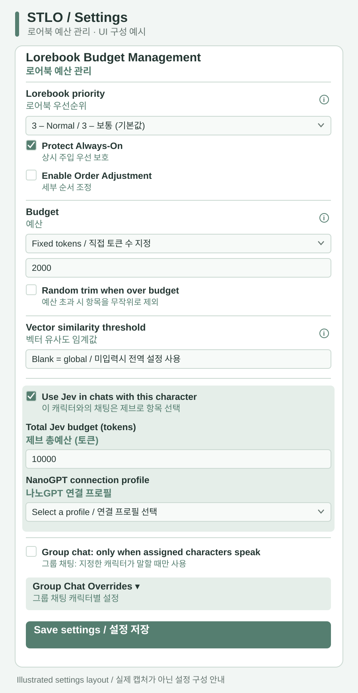
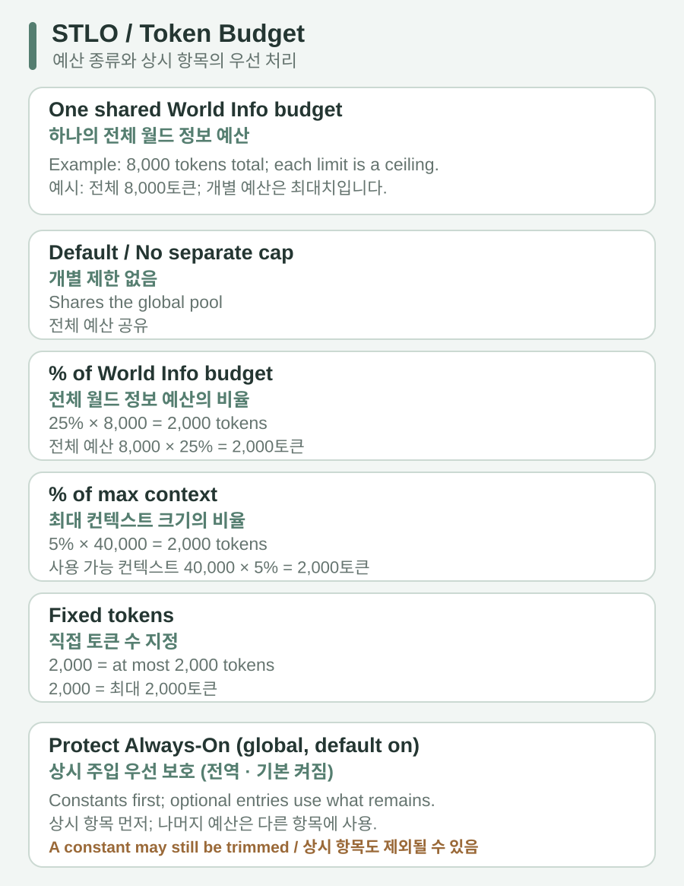

# 📚 ST Lorebook Ordering (STLO) — Ambasa Fork

**A SillyTavern extension for managing lorebook priorities, per-lorebook token limits, and optional per-lorebook vector similarity thresholds.**

This is an independent fork of [ST Lorebook Ordering by aikohanasaki](https://github.com/aikohanasaki/SillyTavern-LorebookOrdering), based on upstream v2.2.4. The original extension provides the core priority, budget, order adjustment, random trimming, and group-chat features. This fork retains those features and adds options for a particular lorebook-management workflow. Many thanks to aikohanasaki for the original design and implementation.

[English](#-installation-and-first-steps) · [한국어](#-stlo-포크--로어북-예산-관리) · [한국어 Notion 사용 설명서](https://app.notion.com/p/422a96b06fd481c3afd5c3c90288ba3a) · [Original STLO](https://github.com/aikohanasaki/SillyTavern-LorebookOrdering)

## 📸 Settings Preview

<p align="center">
  <a href="assets/readme/mobile/stlo-settings-guide-mobile.svg"></a>
</p>

The diagrams in this README are illustrated guides based on the fork's settings, not screenshots. The bilingual labels explain the controls; the current interface retains Korean-only labels for some fork-specific controls.

## 📥 Installation and First Steps

1. Back up your lorebooks and settings. If you have upstream STLO installed, disable or remove it before enabling this fork. Do not run both at the same time.
2. In SillyTavern, open **Extensions → Install extension** and paste:

   ```
   https://github.com/AmbasaS2/SillyTavern-LorebookOrdering
   ```

3. Install and reload SillyTavern. Use a recent SillyTavern version with the `WORLDINFO_SCAN_DONE` event (e.g. the 1.18 series) for per-lorebook budget trimming.
4. Open **Extensions menu → 로어북 예산 관리 (Lorebook Budget Management)**, choose a lorebook, configure the settings, and click **Save settings**.

## 🧭 How to Use

<p align="center">
  <a href="assets/readme/mobile/stlo-workflow-guide-mobile.svg"></a>
</p>

The menu shows the current character's primary and additional linked lorebooks first. Enable **모든 로어북 보기 (Show all lorebooks)** to choose any available book. When no current character can be identified, the full list is shown. The filter only changes the selection list; it does not connect, disconnect, or activate any lorebooks.

The original slash command is retained: `/stlo My Lorebook` selects the named book in the World Info editor and opens its STLO settings. The name is case-insensitive.

## ⚙️ Priority and Order

| Setting | Description |
|---|---|
| **Lorebook priority** | 1–5, with 3 as the default. Higher values are processed earlier. |
| **Order adjustment** | Optional value from −10,000 to +10,000; positive values move entries earlier, negative values later. |
| **Group chats only** | Apply the main order adjustment only during group chat turns. |
| **Protect Always-On** | Global fork option, enabled by default. Gives constant entries budget priority over other entries, including Sticky cases. |

Priority and order adjustment are inherited from upstream. The processing order uses `priority × 10,000 + adjustment + entry order` (the entry order contribution is capped at 9,999). Large adjustments can cross priority bands; use small adjustments for fine-tuning. These controls affect World Info processing, not an entry's configured prompt insertion position or activation conditions.

### Protect Always-On (fork option)

When enabled, constant/always-on entries are processed before non-constant entries across lorebooks. Per-book trimming also considers constants first. The fork accounts for native Sticky precedence when reconciling the shared budget.

This is a **global** setting, not a setting for each book. Saving a change from any lorebook applies it to all. It is not a guarantee that all constants will fit: a constant can still be excluded if its book's cap or the overall World Info budget is insufficient. Entries explicitly configured to ignore the budget retain that behavior.

Disable this option if you prefer the original priority behavior.

## 📦 Per-Lorebook Token Budget

<p align="center">
  <a href="assets/readme/mobile/stlo-budget-guide-mobile.svg"></a>
</p>

All lorebooks share SillyTavern's global World Info budget. A per-book budget is an upper limit, not a reserved allocation.

| Mode | Description |
|---|---|
| **Default / no separate cap** | Let the book share the global World Info budget without an extra STLO cap. |
| **% of World Info budget** | Limit the book to 1–100% of the current World Info pool. |
| **% of max context** | Limit it to 1–100% of the prevailing usable context size. |
| **Fixed tokens** | Limit it to a specified positive integer number of tokens. |

For example, 25% of an 8,000-token World Info budget equals a 2,000-token per-book ceiling. A book may use less, and other books do not receive guaranteed reservations.

**Random trim** is an upstream feature. Instead of always considering entries in order, it shuffles the selection when applying a per-book cap. With Protect Always-On enabled, constants retain their order and only non-constant entries are shuffled.

The fork trims structured activated entries before the final prompt is assembled instead of deleting matching strings from prompt text. With recursive scanning, an entry excluded from the final prompt may already have triggered another entry; trimming does not undo all earlier activation effects.

## 🔎 Per-Lorebook Vector Similarity Threshold (fork option)

<p align="center">
  <a href="assets/readme/mobile/stlo-vector-guide-mobile.svg"></a>
</p>

This option applies to World Info vector retrieval; it does not replace SillyTavern's Vector Storage configuration or enable vectorization for you.

- **Blank:** use the existing global vector similarity threshold.
- **0–1:** explicitly override the similarity threshold for this lorebook. A higher threshold generally requires a closer match; the appropriate value depends on the embedding model and content.
- Save the settings to apply the override. Clear the field and save to return to the global threshold.

For example, a memory book could use 0.35 while a world lorebook uses 0.60. These values illustrate the feature; they are not universal recommendations.

**A similarity threshold is a retrieval filter, not a token budget.** The inherited per-book budget limits the amount of activated lore that may be injected. The fork does not allocate a separate vector-only token budget or multiply the global Vector Storage maximum entry count.

When all queried books use the same threshold, the fork keeps a single native vector query. When multiple thresholds are used, it groups books by threshold and sends separate queries. It merges the results in round-robin order, removes duplicate hashes, and caps the combined result at the original global maximum. The backend response does not include similarity scores, so cross-group score ranking is not reproduced.

Different threshold groups can increase vector requests, latency, and provider costs. Leave the field blank if you do not need book-specific thresholds. Other vector queries, including chat vectorization, are outside this override.

## 🎭 Group Chat Overrides

The original group-chat controls remain available. Expand **Group Chat Overrides** to assign characters to priority levels and optionally adjust order for those characters. Unassigned characters use the book's normal priority.

Enable **Only activate for specific characters** to limit the book to turns by assigned characters. If enabled without assignments, the book is excluded on group-chat speaking turns. Single-character chats use the normal settings.

## 🔧 What This Fork Changes

| Feature | Original STLO v2.2.4 | Ambasa fork |
|---|---|---|
| Priority, order, budget modes, random trim | Included | Retained |
| Group-chat overrides and `/stlo` | Included | Retained |
| Settings access | World Info editor button | Extensions-menu picker; character-linked filter and show-all |
| Constant entries | Original order and budget behavior | Optional global always-on priority |
| Vector similarity threshold | Native global vector setting | Optional per-lorebook threshold |
| Settings layout | Upstream interface | Compact layout, expandable controls, clickable help |
| Budget enforcement | Upstream implementation | Structured scan-time trimming and scan-local settings/token reuse |

[Compare the fork's code changes](https://github.com/AmbasaS2/SillyTavern-LorebookOrdering/compare/c593986c315c60292f8f4b888d1fdda65517ba6c...17fa72b739f833c40d8398982c26ff19b5a1b5af) (upstream base to the documented fork code, excluding later documentation commits).

## 📌 Compatibility and Data

- Per-lorebook trimming requires `WORLDINFO_SCAN_DONE`. The fork does not perform final-prompt substring trimming as a fallback on older SillyTavern versions. The original pre-scan total-budget fallback remains.
- STLO 2.x no longer requires the older “evenly” insertion strategy check; the inherited older README and guides may describe earlier behavior. This fork does not enforce that check.
- Book settings are stored in the lorebook's existing `stlo` data; Protect Always-On is stored in extension settings. Settings are applied with the Save button. If a previously configured book unexpectedly opens with default values, load it in the World Info editor first and reopen the settings before saving.
- Do not enable upstream and this fork simultaneously. Back up your lorebook files before switching. To return to upstream, disable/remove this fork and enable only upstream.
- The diagrams and instructions describe the code at [17fa72b7](https://github.com/AmbasaS2/SillyTavern-LorebookOrdering/commit/17fa72b739f833c40d8398982c26ff19b5a1b5af), based on upstream manifest version 2.2.4. They are not a claim of compatibility testing on every SillyTavern version, browser, or extension combination.

---

# 📚 STLO 포크 · 로어북 예산 관리

**로어북별 우선순위와 토큰 예산을 설정하고, 필요에 따라 로어북마다 벡터 유사도 임계값을 다르게 지정하는 실리태번 확장입니다.**

[aikohanasaki님의 ST Lorebook Ordering](https://github.com/aikohanasaki/SillyTavern-LorebookOrdering) v2.2.4를 기반으로 만든 포크입니다. 원본에서 제공하는 우선순위, 예산, 세부 순서, 랜덤 트리밍, 그룹 채팅 기능을 그대로 사용하며, 특정 로어북 주입 방식에 맞춘 설정을 추가했습니다.

[한국어 Notion 사용 설명서](https://app.notion.com/p/422a96b06fd481c3afd5c3c90288ba3a) · [원본 STLO](https://github.com/aikohanasaki/SillyTavern-LorebookOrdering)

## 📸 설정 화면

<p align="center">
  <a href="assets/readme/mobile/stlo-settings-guide-mobile.svg"></a>
</p>

이미지는 현재 코드에 맞춘 한영 병기 기능 안내입니다. 실제 화면 캡처가 아니며, 새로 추가한 메뉴·일부 설정의 실제 화면 표기는 현재 한국어로 고정되어 있습니다.

## 📥 설치 및 사용 시작

1. 로어북 파일과 설정을 백업합니다. 원본 STLO가 설치되어 있다면 포크와 동시에 활성화하지 않도록 먼저 비활성화하거나 제거합니다.
2. 실리태번 **확장 → 확장 설치**에서 아래 주소를 붙여넣습니다.

   ```
   https://github.com/AmbasaS2/SillyTavern-LorebookOrdering
   ```

3. 설치 후 새로고침합니다. 로어북별 예산 트리밍은 `WORLDINFO_SCAN_DONE`을 지원하는 최근 버전(예: 1.18 계열)을 권장합니다.
4. **확장 메뉴 → 로어북 예산 관리**에서 책을 선택한 뒤 설정을 저장합니다.

## 🧭 사용 흐름

<p align="center">
  <a href="assets/readme/mobile/stlo-workflow-guide-mobile.svg"></a>
</p>

현재 캐릭터의 기본·추가 연결 로어북을 먼저 보여 줍니다. **모든 로어북 보기**에 체크하면 다른 책도 선택할 수 있습니다. 현재 캐릭터를 특정할 수 없으면 전체 목록을 보여 줍니다. 목록을 필터링해도 실제 로어북 연결이나 활성화 여부는 바뀌지 않습니다.

원본의 `/stlo 로어북 이름` 명령어도 남아 있습니다. 월드 정보 편집기에서 해당 로어북을 선택하고 설정창을 엽니다.

## ⚙️ 우선순위와 순서

| 설정 | 설명 |
|---|---|
| **로어북 우선순위** | 1~5, 기본 3. 숫자가 클수록 먼저 처리합니다. |
| **세부 순서 조정** | −10,000~+10,000. 양수는 앞당기고 음수는 늦춥니다. |
| **그룹 채팅에만 적용** | 세부 순서 조정을 그룹 채팅에서만 적용합니다. |
| **상시 주입 우선 보호** | 포크에서 추가한 전역 옵션. 기본 켜짐. 상시 항목을 다른 항목보다 먼저 고려합니다. |

원본의 처리 순서 계산은 `우선순위 × 10,000 + 세부 순서값 + 항목 순서`입니다(항목 순서값의 상한은 9,999). 큰 조정값은 다른 우선순위 단계에도 영향을 줄 수 있습니다. 우선순위는 월드 정보 처리 순서이며 항목의 프롬프트 삽입 위치나 활성화 조건을 바꾸지 않습니다.

### 상시 주입 우선 보호

모든 로어북에 공통 적용됩니다. 켜면 상시 항목이 키워드·벡터 등 다른 항목보다 먼저 예산을 사용하도록 처리합니다. Sticky 항목이 공간을 먼저 사용하는 경우도 고려하며, 책별 예산 트리밍 역시 상시 항목부터 계산합니다.

상시 항목의 주입을 무조건 보장하는 기능은 아닙니다. 개별 또는 전체 예산을 초과하면 상시 항목도 순서대로 제외될 수 있습니다. 기존에 '예산 무시'가 설정된 항목은 그 설정을 유지합니다. 원래 순서 방식이 더 맞는 경우 끄면 됩니다.

## 📦 로어북별 예산

<p align="center">
  <a href="assets/readme/mobile/stlo-budget-guide-mobile.svg"></a>
</p>

모든 로어북은 전체 월드 정보 예산을 공유합니다. 개별 예산은 미리 확보되는 공간이 아니라 해당 로어북의 최대 사용량입니다.

| 예산 종류 | 설명 |
|---|---|
| **개별 제한 없음 (전체 예산 공유)** | 별도 STLO 제한을 추가하지 않습니다. |
| **전체 월드 정보 예산의 비율 (%)** | 전체 월드 정보 예산의 1~100%를 최대치로 설정합니다. |
| **최대 컨텍스트 크기의 비율 (%)** | 현재 사용 가능 컨텍스트의 1~100%를 최대치로 설정합니다. |
| **직접 토큰 수 지정** | 양의 정수 토큰 수를 최대치로 지정합니다. |

예를 들어 전체 월드 정보 예산이 8,000토큰이고 어떤 책을 25%로 설정했다면, 그 책은 최대 2,000토큰을 사용할 수 있습니다. 실제 주입량은 더 적을 수 있습니다.

**예산 초과 시 항목을 무작위로 제외**는 원본 STLO의 랜덤 트리밍 기능입니다. 상시 주입 우선 보호를 켜면 상시 항목은 기존 순서를 유지하고 나머지 항목을 섞습니다.

포크에서는 최종 프롬프트에서 일치하는 문자열을 찾아 제거하는 대신 활성화 항목 구조에서 직접 제외합니다. 재귀 검색을 사용하면 최종 주입에서 제외된 로어도 앞선 검색 과정에서 다른 로어를 활성화했을 수 있습니다.

## 🔎 로어북별 벡터 유사도 임계값

<p align="center">
  <a href="assets/readme/mobile/stlo-vector-guide-mobile.svg"></a>
</p>

벡터화된 로어북을 검색할 때 사용할 유사도 기준입니다. 실리태번의 벡터 저장소 설정 자체를 대체하거나 로어북을 자동으로 벡터화하지 않습니다.

- 미입력: 전역 벡터 유사도 임계값을 사용합니다.
- 0~1 입력: 해당 로어북의 검색 임계값을 지정합니다. 일반적으로 높을수록 관련성이 높은 후보만 남습니다.
- 다시 전역값을 쓰려면 입력칸을 비우고 저장합니다.

메모리 로어북 0.35, 세계관 로어북 0.60과 같은 설정이 가능합니다. 위 값은 설정 예시이며 특정 모델의 권장값이 아닙니다.

**임계값은 검색 후보를 결정하는 기준이고, 예산은 활성화된 로어가 얼마나 주입될 수 있는지의 상한입니다.** 기존의 로어북별 예산을 활용하며, 벡터 전용 토큰 예산을 별도로 추가하거나 검색 최대 항목 수를 책마다 늘리는 기능은 아닙니다.

같은 임계값을 쓰는 로어북들은 단일 벡터 검색 요청을 사용합니다. 서로 다른 값을 쓰는 로어북이 함께 검색되면 임계값별로 요청을 나누고, 반환된 결과를 순환 배분 방식으로 합쳐 중복을 제거합니다. 합산 결과는 전역 최대 항목 수를 넘기지 않습니다. 응답에 유사도 점수가 없으므로 서로 다른 그룹을 점수순으로 다시 정렬하지 않습니다.

임계값 그룹이 늘어나면 벡터 제공자에 따라 요청 수, 비용, 지연이 늘어날 수 있습니다. 필요 없다면 입력하지 않는 것을 권합니다. 채팅 벡터화 등 다른 벡터 요청에는 적용되지 않습니다.

## 🎭 그룹 채팅

원본의 **그룹 채팅 캐릭터별 설정**을 펼치면 우선순위 단계별 캐릭터와 세부 순서를 지정할 수 있습니다. 별도로 지정하지 않은 캐릭터는 책의 기본값을 사용합니다.

**지정한 캐릭터가 말할 때만 사용**을 켜면 배정한 캐릭터의 그룹 채팅 발언 차례에만 해당 로어북을 사용합니다. 배정한 캐릭터가 없으면 그룹 채팅 발언 차례에 해당 책이 제외됩니다. 1:1 채팅은 일반 설정을 사용합니다.

## 🔧 원본과 달라진 점

| 기능 | 원본 STLO v2.2.4 | 포크 |
|---|---|---|
| 우선순위·세부 순서·예산·랜덤 트리밍 | 지원 | 유지 |
| 그룹 채팅 설정, /stlo | 지원 | 유지 |
| 설정 접근 | 월드 정보 편집기 버튼 | 확장 메뉴, 현재 캐릭터 연결 책 필터 |
| 상시 주입 | 기존 순서·예산 처리 | 전역 우선 보호 선택 추가 |
| 벡터 유사도 임계값 | ST 전역 설정 | 로어북별 설정 선택 추가 |
| 설정 UI | 기존 구성 | 좁은 화면에 맞춘 구성, 클릭형 도움말 |
| 예산 트리밍 | 기존 구현 | 활성화 항목 구조에서 제외, 스캔 내 설정·토큰 계산 재사용 |

[원본 기반 코드와 포크 코드 비교](https://github.com/AmbasaS2/SillyTavern-LorebookOrdering/compare/c593986c315c60292f8f4b888d1fdda65517ba6c...17fa72b739f833c40d8398982c26ff19b5a1b5af)

## 📌 호환성 및 저장

- 로어북별 예산 트리밍에는 `WORLDINFO_SCAN_DONE`이 필요합니다. 해당 이벤트가 없는 버전에서는 최종 프롬프트 문자열 제거를 대체 수단으로 사용하지 않습니다. 기존 사전 스캔 전체 예산 제한 경로는 남아 있습니다.
- STLO 2.x부터 이전 버전의 '균등 정렬' 강제 확인은 제거되었습니다. 기존 가이드에는 이전 버전의 동작이 설명되어 있을 수 있습니다.
- 로어북별 설정은 기존 로어북의 `stlo` 데이터에 저장하고, 상시 주입 우선 보호는 확장 설정에 저장합니다. 설정 저장 버튼을 눌러 변경 사항을 반영합니다. 전에 설정한 책이 기본값으로 열린다면 바로 저장하지 말고 월드 정보 편집기에서 책을 불러온 후 다시 확인하세요.
- 원본과 포크를 동시에 활성화하지 마세요. 전환 전 로어북 파일을 백업하세요.
- 문서는 원본 manifest v2.2.4를 기반으로 한 [17fa72b7](https://github.com/AmbasaS2/SillyTavern-LorebookOrdering/commit/17fa72b739f833c40d8398982c26ff19b5a1b5af) 코드를 기준으로 작성했습니다. 모든 기기와 확장 조합의 호환성을 검증했다는 의미는 아닙니다.

---

## 🙏 Credits, Original Documentation & License

- **Original ST Lorebook Ordering:** [aikohanasaki](https://github.com/aikohanasaki/SillyTavern-LorebookOrdering)
- **SillyTavern-MemoryBooks:** [STMB](https://github.com/aikohanasaki/SillyTavern-MemoryBooks) and the original [STMB + STLO guides](guides/).
- **Original documentation:** [upstream README](https://github.com/aikohanasaki/SillyTavern-LorebookOrdering), [translated readmes](readmes/), [guides](guides/), [original changelog](CHANGELOG.md). These document the upstream extension and may not reflect this fork's new controls.
- **Fork modifications and documentation:** AmbasaS2.
- **License:** [GNU Affero General Public License v3.0](LICENSE). Original author attribution, license, and upstream history are retained.

Thank you to the original STLO creator and contributors for making this work possible.