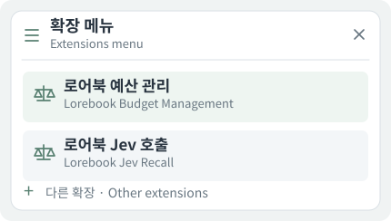
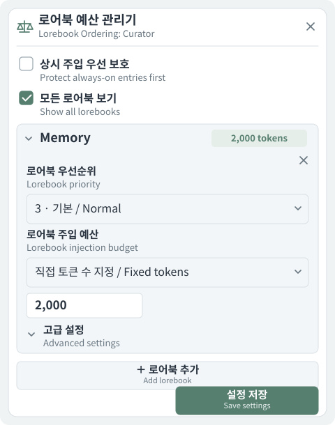
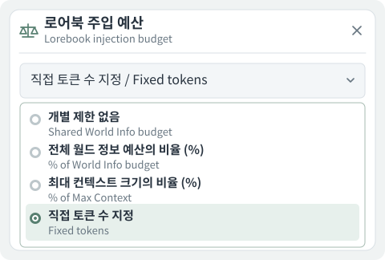
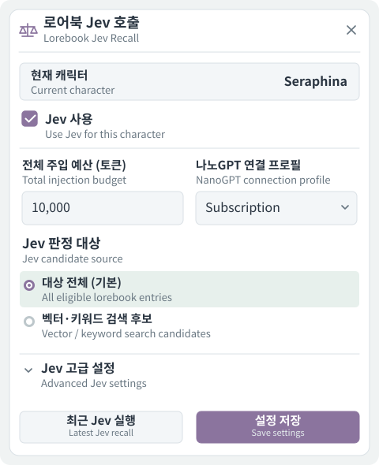
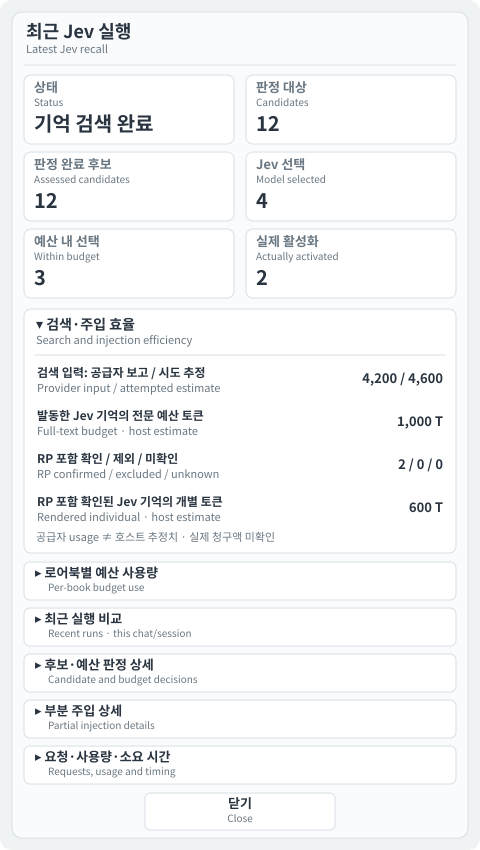
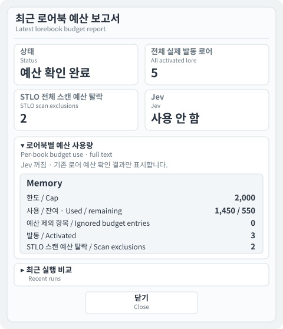
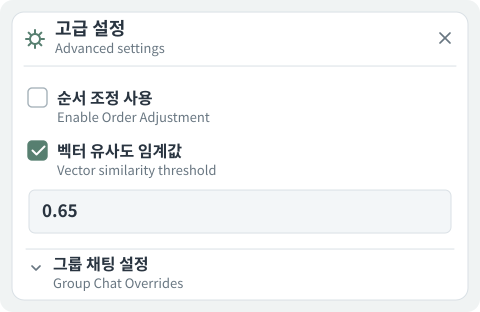

# 📚 Lorebook Ordering for Sloths

**Scene-aware lore recall with Jev, plus lorebook priorities, token budgets, always-on protection, and optional per-lorebook vector thresholds for SillyTavern.**

This is a fork of [ST Lorebook Ordering by aikohanasaki](https://github.com/aikohanasaki/SillyTavern-LorebookOrdering), based on upstream v2.2.4. The original extension provides the core priority, budget, order adjustment, random trimming, and group-chat features. This fork retains those features and adds Jev-based lore selection, always-on protection, and book-specific vector settings. Many thanks to aikohanasaki for the original design and implementation.

[English](#-installation-and-first-steps) · [한국어](#-게으름뱅이를-위한-로어북-예산-관리기) · [Original STLO](https://github.com/aikohanasaki/SillyTavern-LorebookOrdering)

**Start here — which menu should I use?**

| Problem | Menu |
| --- | --- |
| One book uses too many tokens | **Lorebook Budget Management** |
| Relevant old events are not recalled | **Lorebook Jev Recall** (optional) |

These are independent menus. Jev is off for new characters. Lorebook Ordering recalls existing lore; it does not create memories.


**Interface language:** Automatically follows SillyTavern's UI language (English fallback). Lorebook contents, prompts, and settings are not translated.

## 📥 Installation and First Steps

1. Back up your lorebooks and settings. If you have upstream STLO installed, disable or remove it before enabling this fork. Do not run both at the same time.
2. In SillyTavern, open **Extensions → Install extension** and paste:

   ```
   https://github.com/AmbasaS2/SillyTavern-LorebookOrdering
   ```

3. Install and reload SillyTavern. Use a recent SillyTavern version with the `WORLDINFO_SCAN_DONE` event (e.g. the 1.18 series) for Jev and per-lorebook budget trimming.
4. Open **Extensions menu → 로어북 예산 관리 (Lorebook Budget Management)**, edit one or more lorebooks in collapsible cards, then save them together. For character-level Jev activation and shared settings, open **Lorebook Jev Recall** directly from the extensions menu.

## Who is this for?

- Manage several lorebooks with independent priorities and token ceilings without sacrificing important character settings or world lore.
- Protect recent memories and essential always-on entries within available budgets.
- Use optional Jev to recall relevant old promises, events and habits even when exact keywords do not match.
- Keep native keyword/vector recall and set independent per-book vector similarity thresholds.
- Control lorebook priority, order and activation by speaking character in group chats.
- Configure multiple books together, opt into Jev per character and exclude specific books, and inspect the latest recall report for selection, budget exclusions, token estimates and timing.

Jev is optional. You can use this fork solely for book-level priority, budgets and always-on protection, including the new budget-only report. With compatible [WorldInfo Info of Sloth](https://github.com/AmbasaS2/SillyTavern-WorldInfoInfo) .13 and STLO .6, verified inserted Jev entries show a 🔮 source indicator and optional shared metrics. Neither extension requires the other.

## ⚡ Quick start

**Current version: 2.2.4-ambasa.7.**

> **Choose a book → set priority and budget → save → continue RP.**
>
> World Info supplies facts and memories to your RP model. Lorebook Ordering manages each book's priority and maximum contribution. Use Jev only if you want scene-aware recall; neither Jev nor Memory Books is required for budget management.

<p align="left"></p>

**A. Budget management (no Jev required)**

1. Install only this fork and reload. Use SillyTavern 1.18 with the structured World Info scan event for budget trimming and Jev.
2. Open Extensions → 로어북 예산 관리 (Lorebook Budget Management). Add books; set priority (1–5), cap and optional Protect Always-On. Save.
3. Generate a normal RP reply. If you use WorldInfo Info, open the floating book to check activated entries. If native keyword/vector recall works for you, stop here.

**B. Optional scene-aware recall with Jev**

1. Prepare the subscription-only NanoGPT Custom connection profile below. Open Lorebook Jev Recall, enable it for the current character, select the profile and total injection budget, then save.
2. Generate a normal RP reply and check the latest recall report if needed. Compatible WorldInfo Info .13 marks verified inserted Jev entries with 🔮 and supports shared metrics.

## 📖 How to use

> The bilingual illustrations are simplified UI mock-ups based on the extension controls in SillyTavern, not screenshots. Values and lorebooks are illustrative examples.

### 1. Open Lorebook Budget Management

<p align="left"></p>

#### Choose your books

- The current character's primary and additional linked books appear first.
- **Add lorebook:** add more linked books. The manager initially opens the current or first available linked book.
- **Show all lorebooks (모든 로어북 보기):** reveal any available book. If there is no identifiable current character, the full list appears.
- Expand or collapse each card to see its priority and budget. Removing a card only removes it from the editing list.
- Save once to write changed settings only; failed saves remain available for retry. Global always-on protection is saved once for all books.

The selection filter and card removal do **not** activate, link, unlink or delete lorebooks.

The original command `/stlo My Lorebook` selects a named book in World Info and opens its STLO settings (case-insensitive).

#### What can I configure?

**Budget Management — book settings**

| Control | Purpose |
| --- | --- |
| Priority (1–5) | Give important books first consideration; default 3 |
| Protect Always-On | Shared opt-in; consider constants first; default off |
| Order adjustment | Fine-tune processing order |
| Per-book budget | Maximum contribution; also a preferred share with Jev |
| Random trim | Vary which already-active ordinary entries fit |
| Vector similarity threshold | Book-specific native vector search; blank uses global setting |
| Exclude this lorebook from Jev | Keep a book on native activation; shown with current-character Jev or group settings |
| Group chat overrides | Change priority or activation by speaking character |

**Lorebook Jev Recall — optional character and shared settings**

- Use Jev: switch on/off for the current character. Groups use book settings.
- Connection profile and total Jev injection budget: shared settings.
- Candidate source (including opt-in Adaptive), reading scope, selection prompt and experimental partial injection: shared settings.

#### My everyday workflow

For example, with a global World Info budget of 8,000 tokens:

| Book | Priority | Individual cap |
| --- | --- | --- |
| Character settings | 5 | Shared pool |
| Worldbuilding | 4 | Shared pool |
| Memory | 3 | 2,000 tokens |

Enable Protect Always-On if you want recent memories considered first. Explicit book budgets receive preferred allocations with Jev; unused space is shared.

- **Native recall:** leave Jev off. Adjust vector thresholds only when needed.
- **Scene-aware recall:** prepare the subscription profile, enable Jev, set its total budget and save. No vector-threshold change is needed for Jev.

Save and continue RP. Reduce a book's cap if it takes too much space. If an essential constant is missing, check both the book and overall budget.

> [!IMPORTANT]
> A budget is a ceiling, not a promise that the book will use that many tokens.

### 2. Priority and order

| Setting | Meaning |
| --- | --- |
| Lorebook priority | 1–5; default 3. Higher values are processed first |
| Order adjustment | −10,000 to +10,000. Positive moves earlier, negative later |
| Group chats only | Apply the main order adjustment only to group turns |
| Protect Always-On | Global, off by default. Constants get budget priority, including Sticky considerations |

**How the original ordering works:** `priority × 10,000 + adjustment + entry order` (entry order contribution capped at 9,999).

Use small adjustments; large values can cross priority bands. These controls change processing order, not configured prompt insertion positions or activation conditions.

#### Protect Always-On (fork option)

- **Scope:** global; saving it from any book applies to all.
- **When on:** constants are processed first across books, including per-book trimming. Native Sticky precedence is considered when reconciling the shared budget.
- **When off:** original priority behavior.

> [!IMPORTANT]
> Constants still need to fit their book cap and the overall World Info budget. Explicit native ignore-budget settings retain their behavior.

### 3. Per-lorebook token budget

<p align="left"></p>

All lorebooks share SillyTavern's global World Info budget. A per-book budget is an upper limit, not a reserved allocation.

| Budget mode | Maximum book contribution |
| --- | --- |
| Default / no separate cap | Share the global World Info pool |
| % of World Info budget | 1–100% of the current World Info pool |
| % of max context | 1–100% of usable context size |
| Fixed tokens | A specified positive integer |

**Example:** 25% of 8,000 World Info tokens = a 2,000-token ceiling. The book may use less; other books are not guaranteed reservations.

#### Random trim

- Shuffles already-active entries when applying a per-book cap, so the same ordinary entries need not always win.
- With Protect Always-On enabled, constants keep their order and ordinary non-constant entries are shuffled.
- Jev picks are considered in relevance order after ordinary native entries during per-book trimming.

#### How trimming works

Lorebook Ordering trims structured activated entries before the final prompt is assembled, instead of removing matching strings from the prompt.

With recursion, a removed entry may already have triggered another entry. Final trimming does not undo every earlier activation effect.

### 4. Optional Jev recall — scene-aware lore selection

**Why use Jev?**

An old promise: “I will never make important decisions without you again.”

A later line: “Why did you hide it from me again?”

Even without matching words, [TypeSafe Jev 1.14](https://nano-gpt.com/models/decisions/typesafe/jev-1.14) can assess whether that promise, a shared joke, unresolved disagreement or character habit is relevant.

Jev is a **decision model**, not your RP writing model. It selects eligible existing lore. Lorebook Ordering ranks approved entries by inclusion probability, applies budgets and passes selected entries to SillyTavern, using full-text admission and full-text injection by default.

- Your normal RP model stays unchanged.
- No new memories, summaries or lore rewrites.
- No additional vector index or server plugin is required.

#### Setup

<p align="left"></p>

To find **Latest Jev recall**, expand **Advanced Jev settings** and scroll to its bottom.

**Step 1 — Prepare NanoGPT**

1. Create or use a subscription API key.
2. Set **Billing → Subscription only** to prevent spending your account balance.
3. Save a **Chat Completion → Custom (OpenAI-compatible)** connection profile in SillyTavern.
4. Set its base URL to `https://nano-gpt.com/api/subscription/v1` and bind the saved key to that endpoint.

The ordinary NanoGPT endpoint or its native connection profile is not selectable for this implementation.

**Step 2 — Enable for your character**

1. Open a one-to-one chat → Extensions menu → **Lorebook Jev Recall**.
2. Check **Use Jev**.
3. Choose the saved NanoGPT profile and **Total injection budget (tokens)**.
4. Save. No separate lorebook selection is needed.

Continue RP normally. Lorebook Ordering automatically requests `typesafe/jev-1.14`. You do not have to change your main API or the saved profile's normal chat model.

> 🦥 **Why NanoGPT only, instead of a direct Jev key?** This fork supports Jev through NanoGPT’s subscription endpoint only. Connecting a Jev key directly would mean installing a separate server plugin… and I was too lazy for that. I'll wait, very patiently, for SillyTavern to support direct Jev keys without a plugin. (The name is not an accident.)

| Scope | Setting |
| --- | --- |
| One-to-one chats | Explicit on/off per character; on covers eligible active, non-excluded books; unset defaults to off even with old book opt-ins |
| Group chats | Book-specific opt-ins, in Budget Management |
| Shared settings | Total budget, connection profile and advanced options |

#### Choose a candidate source

| Mode | What Jev can assess |
| --- | --- |
| **All eligible entries (default)** | Eligible entries in all active, non-excluded books, even if native search misses them |
| **Vector / keyword search candidates** | Only eligible entries found by native search; missed entries cannot be recovered |
| **Switch by input size (experimental)** | Assess all eligible entries up to the estimated input threshold. Above it, assess search results plus extra memory candidates. Use all entries if vector search is unavailable or finds no eligible candidates. |

To keep a book on native activation, use **Exclude this lorebook from Jev** in Budget Management. With Jev off, ordinary native activation continues unchanged.

**Adaptive: when the book gets enormous**

Choose Adaptive to display the full-plan input threshold (default **56,000 estimated tokens**). This is not the injection budget. Above the threshold, eligible native hits are supplemented by durable-memory cues, concise entries, explicit long-term/NPC roles, concrete title/keyword matches and up to three comparable recent records from the same chat. If the coverage union contains every eligible entry, the full route is reported. All added entries still go through the usual Jev judgment and all budgets. This is a heuristic; long implicit memories may still be missed. Keep the default full mode if you prefer completeness of candidate assessment.

**Partial injection (experimental, off by default)**

Expand Advanced Jev settings and check **Partial injection** only if you want to try it. For eligible long structured Timeline/Scene/Result memories, built-in prompts and no reading limits, Jev can choose a safe original-paragraph excerpt in its existing decision batch. The full entry is always an option. Missing/uncertain choices, changed source or ineligible content keep the full text. No saved lore changes and no extra entries are admitted using the space freed by excerpts. Full-text budgets and recursion remain unchanged. The added input may outweigh savings; this is not a guarantee of lower cost or recall quality.

See section 7 for special vector entries and detailed candidate handling.

#### Three budget limits

| Limit | Meaning |
| --- | --- |
| SillyTavern World Info budget | Shared World Info ceiling |
| STLO per-lorebook budget | Maximum contribution per book |
| Total Jev budget (default 10,000 tokens) | Injection ceiling across managed books, excluding outlets; counts their always-on entries first |

**All three limits apply together. They are not added together.**

Example: a Memory book capped at 3,000 tokens already uses 2,000 for constants.

- Remaining room for additional Jev picks: **at most 1,000 tokens**.
- The total Jev budget of 10,000 does not override the book cap.
- Explicit book budgets are also preferred allocations for Jev-approved entries; unused space is shared.

Detailed allocation and native budget exceptions are in section 7.

#### Everyday use and recall results

Save your settings and continue roleplaying. Open the latest recall report when you want to know what was selected.

- See actual activation, candidate assessment, selection, budget admission and elapsed time at a glance.
- Separate shared Jev budget usage and full-text recalled token estimates from provider-reported search input/output, request count and duration. Actual RP inclusion is shown independently; unconfirmed inclusion is not treated as injection.
- All detailed sections start closed: per-book budgets, recent runs, candidate/budget decisions, partial injection (if used), and technical diagnostics with the original request/usage estimates and timing.
- The report keeps up to eight recent completed/cancelled runs in this chat/session as numeric summaries. No persistent prompt history, extra AI request or token count just for opening the report.

<p align="left"></p>

With Jev **off**, the same report action opens the latest lorebook budget report when a native budget-run record exists. It shows observed activations and STLO scan budget exclusions, per-book full-text cap/use/remaining and recent budget runs, not Jev or confirmed RP metrics.

<p align="left"></p>

Open Lorebook Budget Management → **View latest injection calculation** beside the manager title. When a report is available, the compatible Chat Top Bar also shows a scale shortcut next to Memory Books.

If a request fails, choose **Retry Jev / Cancel reply**. Only failed batches are retried; there is no silent keyword fallback. Zero candidates can be a valid result.

#### Input size, subscription usage, and privacy

> [!IMPORTANT]
> **The Jev budget limits injection, not API input.** All candidates in the chosen scope must be assessed, even if only a few are eventually activated.

- Jev receives recent dialogue, ordinary always-on background and candidate lore through NanoGPT. Enable it only if you are comfortable sending that content.
- Eligible generations add a decision request and possible latency. Large inputs can require multiple requests.
- Check your [NanoGPT subscription and billing settings](https://nano-gpt.com/support). Subscription access does not mean unlimited or free usage.

See section 7 for documented request limits, reading scope, and failure handling.

### 5. Optional per-lorebook vector similarity threshold

<p align="left"></p>

When Jev is not used, this option applies to native World Info vector retrieval; it does not replace SillyTavern's Vector Storage configuration or enable vectorization for you.

- **Blank:** use the existing global vector similarity threshold.
- **0–1:** explicitly override the similarity threshold for this lorebook. A higher threshold generally requires a closer match; the appropriate value depends on the embedding model and content.
- Save the settings to apply the override. Clear the field and save to return to the global threshold.

For example, a memory book could use 0.35 while a world lorebook uses 0.60. These values illustrate the feature; they are not universal recommendations.

**A similarity threshold is a retrieval filter, not a token budget.** The inherited per-book budget limits the amount of activated lore that may be injected. The fork does not allocate a separate vector-only token budget or multiply the global Vector Storage maximum entry count.

**What happens with multiple books?**

- Same threshold: one native vector query.
- Different thresholds: group books by threshold, send separate queries, merge in round-robin order and deduplicate hashes.
- Combined results still obey the original global maximum.
- Backend results have no similarity scores, so cross-group score ranking is not reproduced.

Different threshold groups can increase vector requests, latency, and provider costs. Leave the field blank if you do not need book-specific thresholds. Other vector queries, including chat vectorization, are outside this override.

### 6. Group chat overrides

1. Open **Group Chat Overrides** → **Add character**.
2. Set each character's priority and optional order adjustment.
3. Enable **Only use when an assigned character speaks** if the book should be limited to those turns.

- Unassigned characters use the normal book settings.
- If the last option is enabled with no assignments, the book is excluded on group speaking turns.
- Single-character chats use normal settings.
- Existing overrides are loaded without changing their saved format.

### 7. Reference — Jev settings and internal decisions

The basic setup above is sufficient for everyday RP. Read this section when tuning recall or investigating a result.

#### What Jev sees and selects

| Setting | Default |
| --- | --- |
| Recent chat | Last 20 non-system messages |
| Message/entry reading limit | 0 = unlimited (full text) |
| Total injection budget | 10,000 tokens |
| Selection prompt | Balanced |
| Candidate source | All eligible entries |
| Adaptive threshold (only when selected) | 56,000 estimated input tokens |
| Partial injection | Off (experimental) |

- Shared state: recent dialogue + ordinary always-on background in Jev-managed books.
- One independent include/skip decision per eligible candidate; full stored text is used for admission even when a reading limit is set.
- Default injection is full text. Optional partial injection adds an excerpt-safety question only within existing request limits, using shared source text; full-text activation and budget reconciliation happen first.
- Eligible ordinary non-constant entries can be keyword-based or vector-marked. Disabled entries are not candidates; only active books are considered.

**Existing special activation rules stay intact:**

- Always-on (counted first for budgeting).
- Outlets, managed side prompts and explicit activation decorators.
- Sticky, cooldown, delay and recursion-only.
- Character filters and trigger restrictions.

Saved lore and activation settings are not rewritten. No automatic memory creation or summarization.

#### Shared settings and prompts

Configure recent-message count, optional reading limits, Strict / Balanced / Generous or a custom prompt. Balanced keeps the original criteria.

The prompt library supports full editing, named presets, save, rename, save as, import/export and delete. Apply changes with the outer **Save Settings** button.

Increasing input can increase costs even when the call count stays the same. Old separate Jev reserve values remain in saved book data but are ignored; the existing book budget is its cap and preferred share.

#### Preferred allocations and exceptions

- Explicit per-book caps are preferred allocations for relevant Jev-approved entries, including always-on entries.
- Uncapped books share the remaining pool. Unused preferred space returns to the common pool.
- Book priority resolves competing reservations; all three ceilings still apply.
- After preferred allocations, remaining relevant entries are considered in score order. Original insertion positions/order are retained.
- Native special entries keep native activation rules; their actual injected text counts toward the separate Jev ceiling.
- Explicit native budget exemptions remain exempt from World Info/per-book limits, **not** the separate Jev ceiling in managed books.
- Oversized constants that cannot fit do not reserve space.
- Whole-entry admission, native activation and recursion can leave space unused.

#### Jev candidate source and exclusions — details

**All eligible entries**

- Ordinary World Info vector recall is skipped in managed books.
- Excluded books and chat/Data Bank/file vector recall follow their existing settings.
- A managed book with vector-dependent special entries keeps its whole native collection to preserve special activation and index integrity.

**Vector / keyword search candidates**

- The native vector interceptor runs at its normal position when enabled.
- An extra local candidate scan finds matched entries; Jev assesses eligible entries in non-excluded books.
- No second vector search is performed. Existing per-book thresholds may still split native requests.
- Recursion, group inclusion and budgets can affect candidate discovery and final activation.

**Adaptive (experimental):** the full-plan estimate routes to all entries or native hits plus memory coverage. The compact-entry lane includes entries up to 512 UTF-16 code units; explicit role metadata and concrete title/keyword cues supplement long memories. Comparable recent source positions are limited to the same chat; UID/list order alone is not recency. No second vector pass or additional model stage. The bounded, generation/scope-aware caches do not persist a new index. [Coverage details](docs/jev-adaptive-coverage.md).

**Partial injection (experimental):** requires an eligible long structured Scene, built-in criteria and no reading limits. Offered choices preserve original paragraphs, Timeline/Result, setup/end and relevant cues, with gaps marked; no paraphrase. Only valid choices with reported confidence at least 0.85 are applied, after exact source/forced-key checks at final scan. Conservative estimated input-versus-saving and request-size gates can omit the question entirely; full fallback on low/missing confidence or incompatible content. Saved lore, flags, original budget and recursion are untouched. [Partial-injection details](docs/jev-partial-injection.md).

Disabling Jev leaves ordinary activation unchanged. No saved vector data, lore or activation settings are rewritten.

#### Request limits and error handling

The documented NanoGPT limits and Lorebook Ordering planning estimates:

| Limit | Provider documentation | Local planning target |
| --- | --- | --- |
| Whole request | 64K | 56K |
| Per question | 32K | 28K |

Estimates are not exact provider token counts.

- Use one request when it fits. Otherwise split into batches with identical shared context; provider size rejection can split a batch further.
- All decisions must complete before injection; scores are merged globally.
- If shared context plus one complete question cannot fit, stop before continuing RP. Reduce recent messages or explicitly enable a reading limit.
- Missing connection, invalid response, timeout or other request failure: wait for **Retry Jev / Cancel reply**.
- Retry resends only failed batches, not successful batches or native candidate search.
- Closing the popup or an unrecoverable local preparation failure cancels the reply.
- No automatic retry of ordinary errors, no partial-decision injection, no silent keyword fallback.
- Zero candidates is a valid result. Dry-run previews do not call Jev.

#### What the latest recall report contains

- Status, candidate and selected counts, unassessed entries.
- Budget exclusions and actual activation results.
- Planned/completed batches.
- Estimated attempted input and provider-reported input/output/cache read/write where reported; coverage and timings are separate. Cache tokens are not added again.
- Adaptive route, estimated full-plan cost and coverage counts; partial questions/selected/applied and removed **characters**, not saved tokens.
- Full-text budget estimates and verified individual rendered RP Jev-token sums are different scopes. Without compatible WorldInfo Info evidence, RP inclusion remains unmeasured. Unknown values are not zero and neither report represents an exact API bill.
- Reading-limit truncation and timings. See [measurement contract and scope](docs/memory-metrics-contract-v1.md).

It updates on generation events only. No new DOM observer, polling or repeated UI redraw.

## 🔧 What This Fork Changes

**Jev scene-aware recall**  
**Original STLO v2.2.4**: Not included  
**Current version**: Optional decision-model recall with shared and per-book budgets

**Priority, order, budget modes, random trim**  
**Original STLO v2.2.4**: Included  
**Current version**: Retained

**Group-chat overrides and `/stlo`**  
**Original STLO v2.2.4**: Included  
**Current version**: Retained

**Settings access**  
**Original STLO v2.2.4**: World Info editor button  
**Current version**: Extensions-menu picker; character-linked filter and show-all

**Constant entries**  
**Original STLO v2.2.4**: Original order and budget behavior  
**Current version**: Optional global always-on priority

**Vector similarity threshold**  
**Original STLO v2.2.4**: Native global vector setting  
**Current version**: Optional per-lorebook threshold

**Settings layout**  
**Original STLO v2.2.4**: Upstream interface  
**Current version**: Compact layout, expandable controls, clickable help

**Budget enforcement**  
**Original STLO v2.2.4**: Upstream implementation  
**Current version**: Structured scan-time trimming and scan-local settings/token reuse

[Compare the fork's code changes](https://github.com/AmbasaS2/SillyTavern-LorebookOrdering/compare/c593986c315c60292f8f4b888d1fdda65517ba6c...3ca62a5f98168cad03a6080104cb9f3a45345958) (upstream base to the documented fork code, excluding later documentation commits).

## Troubleshooting

- **Always-on entry missing:** check whether its full text fits the book cap and overall budget.
- **Old memory not recalled:** check active/excluded books, entry eligibility, candidate source and latest Jev report.
- **🔮 in compatible WorldInfo Info:** means a verified inserted Jev entry in the latest compatible viewer, not every candidate approved by Jev.

## 📌 Compatibility and Data

- Jev and per-lorebook trimming require `WORLDINFO_SCAN_DONE`. The fork does not perform final-prompt substring trimming as a fallback on older SillyTavern versions. On older hosts, no unsafe pre-scan budget fallback is used; native activation and budgeting remain in control.
- STLO 2.x no longer requires the older “evenly” insertion strategy check; the inherited older README and guides may describe earlier behavior. This fork does not enforce that check.
- Book settings are stored in the lorebook's existing `stlo` data; Protect Always-On, character-specific Jev switches, the shared Jev budget and connection profile ID are stored in extension settings. Settings are applied with the Save button. If a previously configured book unexpectedly opens with default values, load it in the World Info editor first and reopen the settings before saving.
- Do not enable upstream and this fork simultaneously. Back up your lorebook files before switching. To return to upstream, disable/remove this fork and enable only upstream.
- Earlier setup diagrams illustrate 2.2.4-ambasa.6 at [b4b8449](https://github.com/AmbasaS2/SillyTavern-LorebookOrdering/commit/b4b84499dc4234858ef80e650450c0b88be15d65); the report layout was refreshed in [PR #4](https://github.com/AmbasaS2/SillyTavern-LorebookOrdering/pull/4) for 2.2.4-ambasa.7. Adaptive and partial injection are experimental and opt-in. They are not a claim of compatibility testing on every SillyTavern version, browser, or extension combination.

## 🧩 Works well with

> [!TIP]
> Memory Books creates and maintains memories; STLO recalls them like other eligible lore. WorldInfo Info can show verified inserted Jev lore and share compatible token/evidence measurements, and Lorebook Manager can read those entries. None is required. Jev never changes the RP model or the saved lore.

[Sloth the Lorebook Manager / 로어북 매니저: 게으름뱅이](https://github.com/AmbasaS2/lore-manager) · [Sloth's Memory Books / 게으름뱅이의 메모리북](https://github.com/AmbasaS2/SillyTavern-MemoryBooks) · [WorldInfo Info of Sloth / 게으름뱅이가 읽는 월드인포인포](https://github.com/AmbasaS2/SillyTavern-WorldInfoInfo)

The detailed sections below explain optional settings. Compatibility is version-dependent; it does not guarantee every third-party extension or device.

The new options and report labels are localized in the supported interface languages.

---

<a id="-stlo--로어북-예산-관리"></a>

# 📚 게으름뱅이를 위한 로어북 예산 관리기

**화면 언어:** 실리태번 화면 언어를 자동으로 따릅니다. 지원하지 않는 언어는 영어로 표시하며 로어북 내용·프롬프트·저장 설정은 그대로입니다.


**Jev로 현재 RP에 필요한 로어를 골라 주입하고, 로어북별 우선순위와 토큰 예산까지 관리하는 실리태번 확장입니다.**

[aikohanasaki님의 ST Lorebook Ordering](https://github.com/aikohanasaki/SillyTavern-LorebookOrdering) v2.2.4를 기반으로 만든 포크입니다. 원본에서 제공하는 우선순위, 예산, 세부 순서, 랜덤 트리밍, 그룹 채팅 기능을 그대로 사용하며, Jev를 이용한 로어 선택, 상시 주입 우선 보호, 책별 벡터 설정을 추가했습니다. 원작자님께 감사드립니다.

[원본 STLO](https://github.com/aikohanasaki/SillyTavern-LorebookOrdering)

**딱 두 가지만 기억하세요!**

| 이런 상황이라면 | 열어 볼 메뉴 |
| --- | --- |
| 로어북이 토큰을 너무 많이 쓴다 | **로어북 예산 관리** |
| 지금 필요한 과거 기억을 못 찾는다 | **로어북 Jev 호출** (선택) |

두 메뉴는 독립적입니다. 새 캐릭터의 Jev는 기본 꺼짐이에요. 새 기억을 만드는 확장은 아닙니다.

## 📥 설치 및 사용 시작

1. 로어북 파일과 설정을 백업합니다. 원본 STLO가 설치되어 있다면 포크와 동시에 활성화하지 않도록 먼저 비활성화하거나 제거합니다.
2. 실리태번 **확장 → 확장 설치**에서 아래 주소를 붙여넣습니다.

   ```
   https://github.com/AmbasaS2/SillyTavern-LorebookOrdering
   ```

3. 설치 후 새로고침합니다. Jev 및 로어북별 예산 트리밍은 `WORLDINFO_SCAN_DONE`을 지원하는 최근 버전(예: 1.18 계열)을 권장합니다.
4. **확장 메뉴 → 로어북 예산 관리**에서 필요한 로어북을 카드로 추가하고 예산·우선순위를 한 번에 저장합니다. 캐릭터별 Jev 사용 여부와 공통 설정은 **로어북 Jev 호출**에서 바로 변경합니다.

## 이 확장, 누가 쓰면 좋을까? ✍️(◔◡◔)

- 캐릭터 설정·세계관·메모리북이 서로 예산을 잡아먹지 않도록 책별 우선순위와 최대 토큰을 조절하고 싶은 분
- 최근 기억과 필수 파란불 항목을 다른 로어보다 먼저 보호하고 싶은 분
- 정확한 키워드가 없어도 Jev로 지금 필요한 과거 사건·약속·습관을 불러오고 싶은 분
- 기존 키워드·벡터 호출을 유지하면서 로어북마다 벡터 유사도 임계값을 다르게 설정하고 싶은 분
- 그룹 채팅의 발언 캐릭터별로 책의 우선순위·순서·활성화 여부를 관리하고 싶은 분
- 여러 책의 설정을 한 번에 관리하고 캐릭터별 Jev 사용·책별 제외를 선택하며, 호출 결과에서 판정·선택·예산 제외·입력 토큰·소요 시간을 확인하고 싶은 분

Jev는 선택 기능입니다. 원본 STLO의 책별 우선순위와 예산 관리만 사용해도 됩니다. 이제 Jev 없이도 최근 예산 사용량과 제외 결과를 확인할 수 있어요.

## ⚡ 간단 사용 설명

**현재 버전: 2.2.4-ambasa.7.**

> **책 선택 → 우선순위와 예산 설정 → 저장 → 다시 롤플!**
>
> 로어북은 RP 모델에 설정과 기억을 전달합니다. 예산 관리기는 책별 우선순위와 최대 주입량을 정해요. Jev는 필요한 로어를 고르는 선택 기능이며, 예산 관리만 쓸 분은 메모리북이나 Jev 연결이 필요 없습니다.

<p align="left"></p>

**A. 기본 예산 관리만 사용하기 (Jev 불필요)**

1. 원본과 동시에 켜지 말고 설치·새로고침합니다. 예산 트리밍과 Jev는 구조화된 스캔 이벤트가 있는 실리태번 1.18 계열을 기준으로 합니다.
2. 확장 메뉴 → 로어북 예산 관리 → 책 추가 → 우선순위(1~5)·예산·선택적 상시 주입 우선 보호 → 저장.
3. 평소처럼 롤플하세요. 월드인포인포를 함께 쓴다면 책 버튼으로 발동 로어를 확인합니다. 기본 키워드·벡터로 충분하면 여기까지!

**B. 선택: Jev까지 사용하기**

1. 위 예산 설정을 마친 뒤 아래 구독 전용 NanoGPT Custom 연결 프로필을 준비하고 별도 로어북 Jev 호출 메뉴에서 현재 캐릭터의 Jev 사용·프로필·총예산을 설정해 저장합니다.
2. 평소처럼 롤플하고 최근 호출 결과를 확인합니다. 호환 월드인포인포(.13)에서는 실제 주입이 확인된 Jev 로어에 🔮가 표시됩니다.

## 📖 사용 설명서

> 안내 이미지는 실제 실리태번 확장의 조작 화면을 바탕으로 정리한 한영 병기 UI 목업입니다. 설정값과 로어북은 이해를 돕기 위한 예시입니다.

### 1. 로어북 예산 관리기 메뉴 열기

<p align="left"></p>

#### 책을 추가하고 저장하기

- 현재 캐릭터의 기본·추가 연결 책을 먼저 보여 줍니다.
- **로어북 추가:** 연결된 다른 책을 카드로 추가.
- **모든 로어북 보기:** 다른 책도 선택 가능. 현재 캐릭터를 특정할 수 없으면 전체 표시.
- 카드마다 접기·펼치기, 우선순위·예산 요약 확인.
- X: 편집 목록에서만 제외.
- 변경한 설정만 저장하며 실패한 책은 다시 시도할 수 있습니다.

목록 필터나 카드 제거로 실제 로어북의 연결·활성화 상태가 바뀌거나 책이 삭제되지는 않습니다.

원본 명령어 `/stlo 로어북 이름`으로 월드 정보 편집기의 해당 책을 선택하고 설정창을 열 수도 있어요.

#### 메뉴별로 할 수 있는 것

**로어북 예산 관리 — 책별 설정**

| 설정 | 기능 |
| --- | --- |
| 로어북 우선순위 (1–5) | 중요한 책을 먼저 처리 (기본 3) |
| 상시 주입 우선 보호 | 파란불 우선 고려. 공통 옵션, 기본 꺼짐 |
| 세부 순서 조정 | 순서를 미세 조절 |
| 예산 | 책의 최대 주입량. Jev 사용 시 우선 배정 기준 |
| 예산 초과 시 무작위 제외 | 이미 발동한 일반 항목 선택 순서 섞기 |
| 벡터 유사도 임계값 | 기본 벡터 검색 기준. 빈 칸은 전역값 |
| 이 로어북은 Jev 판정에서 제외 | 해당 책은 기존 발동 방식 유지. 현재 캐릭터의 Jev 사용 시 표시 (그룹·기존 관리 예외 유지) |
| 그룹 채팅 설정 | 발언 캐릭터별 우선순위·활성 여부 |

**로어북 Jev 호출 — 선택 기능**

- 현재 캐릭터 Jev 사용 체크/해제 (그룹은 기존 책별 설정).
- 전체 주입 예산과 나노GPT 연결 프로필: 공통값.
- 판정 대상·인식 범위·판정 프롬프트: 공통 고급 설정.

1:1만 한다면 그룹 채팅 설정은 건드릴 필요 없습니다.

#### 평소에는 이렇게 씁니다

예: 전체 월드 정보 예산이 8,000토큰인 경우.

| 책 | 우선순위 | 개별 예산 |
| --- | --- | --- |
| 👤 캐릭터 설정 | 5 | 전체 예산 공유 |
| 🌍 세계관 | 4 | 전체 예산 공유 |
| 📕 메모리북 | 3 | 최대 2,000토큰 |

파란불 기억을 먼저 넣고 싶다면 **상시 주입 우선 보호**를 켜세요. Jev 사용 시 개별 예산을 우선 배정하고 남은 몫은 공유합니다.

- **키워드·벡터로 충분하다면:** Jev OFF. 필요할 때만 책별 벡터 임계값 조절.
- **Jev를 쓰고 싶다면:** 아래 나노GPT 연결·총예산 설정. Jev 때문에 기존 벡터 임계값을 바꿀 필요는 없습니다.

설정 저장 후 다시 롤플!

- 메모리북이 토큰을 너무 많이 먹으면 → 개별 예산 줄이기.
- 중요한 파란불 기억이 빠지면 → 개별 예산과 전체 월드 정보 예산 확인.

### 2. 우선순위와 순서

| 설정 | 설명 |
| --- | --- |
| 로어북 우선순위 | 1~5, 기본 3. 숫자가 높을수록 먼저 처리 |
| 세부 순서 조정 | −10,000~+10,000. 양수는 먼저, 음수는 나중 |
| 그룹 채팅에만 적용 | 세부 순서 조정을 그룹 채팅에서만 사용 |
| 상시 주입 우선 보호 | 포크에서 추가한 전역 옵션. 체크하면 상시 항목부터 고려 |

별도 우선순위나 순서 조정을 설정하지 않으면 실리태번 기본 순서를 유지합니다.

**원본의 처리 순서 계산:** `우선순위 × 10,000 + 세부 순서값 + 항목 순서` (항목 순서값 최대 9,999).

큰 조정값은 다른 우선순위 단계에 영향을 줄 수 있어요. 작은 값부터 사용하세요. 이 설정은 처리 순서만 바꾸며 실제 프롬프트 삽입 위치나 활성화 조건은 바꾸지 않습니다.

#### 🔵 상시 주입 우선 보호

- 모든 로어북 공통. 기본값은 꺼짐.
- 켜면 상시 항목의 예산을 먼저 고려합니다.
- Sticky도 고려하지만 실제 삽입 순서값은 변경하지 않습니다.
- 기존에 명시적으로 저장한 켜짐/꺼짐 값은 유지합니다.
- 원래 순서가 좋다면 끄면 됩니다.

> [!IMPORTANT]
> **파란불도 무조건 들어가는 것은 아닙니다.** 개별 또는 전체 예산이 부족하면 상시 항목도 제외될 수 있어요. 기존 '예산 무시' 설정은 유지합니다.

### 3. 로어북별 예산

<p align="left"></p>

모든 로어북은 전체 월드 정보 예산을 공유합니다. 개별 예산은 미리 확보되는 공간이 아니라 해당 로어북의 최대 사용량입니다.

| 예산 방식 | 책의 최대 사용량 |
| --- | --- |
| 개별 제한 없음 (전체 예산 공유) | 별도 STLO 제한 없이 전체 예산 공유 |
| 전체 월드 정보 예산의 비율 (%) | 전체 월드 정보 예산의 1~100% |
| 최대 컨텍스트 크기의 비율 (%) | 현재 사용 가능 컨텍스트의 1~100% |
| 직접 토큰 수 지정 | 양의 정수 토큰 수 |

**예시:** 전체 월드 정보 예산 8,000토큰 × 25% = 최대 2,000토큰.

실제 활성 항목이 적거나 전체 예산이 부족하면 그보다 적게 들어갑니다.

#### 예산 초과 시 항목을 무작위로 제외

원본 STLO의 랜덤 트리밍 기능입니다.

- 상시 주입 우선 보호 ON: 상시 항목은 기존 순서 유지, 일반 항목 순서는 섞기.
- 책별 예산 트리밍: 일반 항목 뒤에서 Jev 선택 항목을 판정 점수순으로 고려.

#### 예산에서 제외하는 방식

최종 프롬프트 문자열에서 삭제하지 않고 활성화 항목 구조에서 직접 제외합니다. 재귀 검색에서 이미 다른 로어를 발동시킨 항목이 최종 예산에서 제외돼도 앞선 발동 효과까지 모두 취소되지는 않습니다.

### 4. 선택 기능: Jev로 현재 장면에 필요한 로어 골라 주입

**Jev가 필요한 상황?**

예전 약속: “다시는 중요한 결정을 혼자 내리지 않을게.”

한참 뒤의 대사: “왜 또 나한테 숨겼어?”

같은 키워드가 나오지 않아도 [TypeSafe Jev 1.14](https://nano-gpt.com/models/decisions/typesafe/jev-1.14)가 예전 약속이 지금 필요한지 판정합니다. 둘만의 농담, 풀리지 않은 갈등, 캐릭터의 습관도 같은 방식으로 고려할 수 있어요.

**Jev는 이미 저장된 로어를 골라 주는 판정 모델입니다.**

- 선택된 항목을 점수순으로 예산에 맞게 추려 실리태번에 전달합니다.
- 큰 입력은 자동으로 나눕니다.
- 실제 RP 답변은 평소 사용하던 모델이 생성합니다.
- 별도 벡터 인덱스나 서버 플러그인은 필요 없습니다.
- 새 기억을 만들거나 기존 로어를 요약·수정하지 않습니다.

기존 Jev 출처 표시(월드인포인포 .4 / STLO .1부터 호환)는 유지되며, 최신 월드인포인포 .14 / STLO .7에서는 주입 확인·계측 연동까지 지원합니다. 표시를 위해 별도 검색·AI 호출이 발생하지 않으며 두 확장은 단독 사용도 가능해요.

#### 사용 설정

<p align="left"></p>

**최근 Jev 실행**은 **Jev 고급 설정**을 펼친 뒤 아래쪽에서 찾을 수 있습니다.

**1단계. 나노GPT 연결 준비**

1. 나노GPT 구독 API 키 준비.
2. 잔액 결제를 막으려면 **Billing → Subscription only** 설정.
3. 실리태번 API 연결 → **Chat Completion → Custom (OpenAI-compatible)**.
4. 주소 `https://nano-gpt.com/api/subscription/v1`와 해당 주소에 저장한 키를 연결 프로필로 저장.

일반 나노GPT API 주소나 실리태번 NanoGPT 전용 연결 프로필은 현재 선택할 수 없습니다.

**2단계. 현재 캐릭터에서 Jev 켜기**

1. 1:1 캐릭터 채팅 → 확장 메뉴 → **로어북 Jev 호출**.
2. **Jev 사용** 체크.
3. 나노GPT 연결 프로필·전체 주입 예산 (토큰) 지정.
4. 설정 저장. 별도로 책을 고를 필요는 없어요.

평소처럼 롤플하면 STLO가 `typesafe/jev-1.14`를 자동 지정합니다. 메인 RP API나 프로필의 일반 채팅 모델을 바꿀 필요 없습니다.

> 🦥 **왜 Jev 키는 직접 연동할 수 없고 나노GPT만 되나요?** 이 포크에서는 Jev를 나노GPT 구독 전용 경로로만 사용할 수 있습니다. Jev 키를 직접 연동하려면 별도 서버 플러그인까지 설치해야 하는데요… 제가 귀찮았습니다. 실리태번이 언젠가 플러그인 없이 Jev 키를 직접 연동할 수 있게 해 주는 그날까지 느긋하게 기다리겠습니다. (괜히 게으름뱅이가 아닙니다. 🦥)

| 적용 범위 | 설정 |
| --- | --- |
| 1:1 채팅 | 현재 캐릭터별 ON/OFF. ON은 활성화된 책 중 제외하지 않은 적격 항목 적용. 미설정 캐릭터는 기존 책별 설정과 무관하게 OFF |
| 그룹 채팅 | 로어북 예산 관리의 책별 Jev 설정 사용 |
| 공통 설정 | 총예산·연결 프로필·고급 설정 |

#### 어떤 로어를 Jev에게 보여 줄까요?

| 판정 대상 | 차이 |
| --- | --- |
| **전체 로어북 항목 (기본값)** | 기존 검색에서 놓친 일반 로어까지 평가 |
| **벡터·키워드 검색 후보** | 기존 검색에 걸린 적격 항목만 평가. 놓친 항목은 되살릴 수 없음 |
| **입력량에 따라 자동 전환 (실험)** | 예상 입력량이 기준 이하면 전체를 판정하고, 넘으면 검색 결과에 기억 후보를 보태 판정 |

특정 책만 기존 호출 방식으로 쓰고 싶다면 예산 관리 카드의 Jev 제외 옵션을 사용하세요.

**로어북이 너무 커졌다면? 적응형 (실험)**

Jev 판정 대상에서 **입력량에 따라 자동 전환 (실험)**을 선택하면 **자동 전환 기준 (예상 입력 토큰)**이 나타납니다. 기본값은 56,000입니다. 실제 주입량은 별도의 Jev 전체 예산으로 제한합니다.

- 전체 판정 예상 입력량이 기준 이하면 적격 항목 전체를 판단합니다.
- 기준을 넘으면 기존 검색 후보에 오래된 약속·습관 등 장기 기억 단서, 짧은 기록, 명시적인 LT/NPC 역할, 제목·키워드 일치, 같은 채팅의 비교 가능한 최근 기록을 더합니다.
- 벡터 검색을 사용할 수 없거나 적격 검색 결과가 없으면 전체 판단으로 돌아갑니다.

추가 후보도 Jev의 기존 판정과 모든 예산을 통과해야 합니다. 기억을 완벽하게 찾아낸다는 보장은 없어요. 기본 전체 판단이 잘 맞는 분은 그대로 쓰세요!

**긴 기억 전체를 넣기 부담스럽다면? 부분 주입 (실험)**

Jev 고급 설정 → **부분 주입 (실험)**을 체크합니다. 기본값은 꺼짐.

Timeline/Scene/Result 형식의 적격 긴 기억에서만, 내장 판정 프롬프트를 쓰고 읽기 제한이 없을 때 안전한 발췌를 고를 수 있습니다. 기존 Jev 요청에서 원문 문단을 고르는 방식으로 불확실하면 전문을 유지해요. 원본 로어를 요약하거나 수정하는 기능이 아닙니다.

> [!IMPORTANT]
> 예산과 발동은 여전히 전문 기준입니다. 발췌로 남은 공간에 다른 로어를 더 넣지 않아요. 판정 입력이 늘 수 있어서 실제 절약량이나 비용 절감을 보장하지 않습니다. 두 실험 옵션 모두 필요한 분만 켜 보세요.

특수 벡터 항목과 세부 조건은 아래 7번을 참고하세요.

#### 예산은 세 가지를 함께 적용합니다

| 예산 | 의미 |
| --- | --- |
| 실리태번 전체 월드 정보 예산 | 모든 책을 합친 상한 |
| STLO 로어북별 예산 | 각 책의 최대 사용량 |
| Jev 전체 주입 예산 (기본 10,000토큰) | Jev 적용 책의 실제 주입 상한 (Outlet 제외), 그 책의 상시 항목부터 계산 |

**세 개를 합쳐서 더 많이 넣는 것이 아닙니다!**

메모리북 예산이 3,000토큰이고 파란불 기억이 이미 2,000토큰 들어갔다면?

- Jev가 추가로 고를 수 있는 기억: **최대 1,000토큰**
- Jev 총예산을 10,000으로 정해도 책별 한도는 그대로입니다.
- 기존 책별 예산을 Jev 선택 항목에 우선 배정하며 사용하지 못한 몫은 공유합니다.

세부 배정 방식과 예산 무시 항목은 7번에서 설명합니다.

#### 평소에는 롤플하고 결과만 확인하기

설정 후에는 평소처럼 롤플하세요. 궁금할 때 **최근 Jev 실행 정보**를 열어 보면 됩니다.

- 발동 기억 수, 검색 완료·AI 선택·예산 통과·최종 발동 및 전체 소요 시간을 먼저 확인합니다.
- Jev 공통 예산 사용량과 발동 기억 전문 토큰 추정치를 검색 AI의 공급자 보고 입력/출력 토큰·요청 횟수·요청 소요 시간과 분리합니다. 최종 RP 프롬프트 포함 여부는 별도로 표시하며, 미확인 발동을 실제 주입으로 간주하지 않습니다.
- 로어북별 예산, 최근 실행 비교, 후보·예산 상세, 부분 주입 상세(사용 시), 기술 진단 정보는 기본 접힘입니다. 기존 추정치·캐시·사용량·시간의 상세 수치를 유지합니다.

<p align="left"></p>

**Jev를 끄고 예산 관리만 쓴다면?**

최근 예산 검사 기록이 있다면 같은 보고서 열기 동작으로 **최근 로어북 예산 보고서**를 볼 수 있습니다. 일반 로어의 실제 발동 수와 STLO 예산 탈락 수, 책별 한도·사용·잔여량을 확인해요. Jev 사용량이나 최종 RP 주입량을 지어내지 않습니다.

<p align="left"></p>

입력창 왼쪽 확장 메뉴에서 **로어북 예산 관리**를 열고 제목 오른쪽의 **최근 주입 계산 보기**를 누르세요. 보고서가 있으면 호환 챗탑바의 메모리북 옆 저울 아이콘에서도 열 수 있어요. 최근 실행 비교는 현재 채팅·세션의 최근 8회 숫자 기록이며, 보고서를 여는 것만으로 새 AI 요청이나 토큰 계산이 시작되지는 않습니다.

오류가 나면 **Jev 재시도 / 답변 취소**를 선택합니다. 실패한 묶음만 재시도하고 키워드 호출로 몰래 대체하지 않아요. 후보 0개는 정상 결과일 수도 있습니다.

#### 💸 Jev API 비용과 입력량

> [!IMPORTANT]
> **Jev 전체 주입 예산은 API 입력 한도가 아닙니다.** 선택한 판정 범위의 후보를 읽기 때문에 실제로 몇 개만 발동되더라도 로어북이 크면 입력 토큰이 늘어납니다.

- 최근 대화·일반 상시 주입 배경·후보 로어 본문이 나노GPT를 거쳐 Jev 모델에 전달됩니다.
- 별도 판정 요청으로 시간이 추가될 수 있습니다.
- 구독 포함 여부와 사용량 한도는 [나노GPT 구독·결제 정책](https://nano-gpt.com/support)을 확인하세요. 구독이라고 무조건 무제한·무료인 것은 아닙니다.

입력 제한과 오류 처리의 자세한 설명은 7번에 정리했습니다.

### 5. 선택 기능: 로어북별 벡터 유사도 임계값

<p align="left"></p>

Jev를 사용하지 않을 때 기존 벡터화된 로어북을 검색하는 유사도 기준입니다. 실리태번의 벡터 저장소 설정 자체를 대체하거나 로어북을 자동으로 벡터화하지 않습니다.

- 미입력: 전역 벡터 유사도 임계값을 사용합니다.
- 0~1 입력: 해당 로어북의 검색 임계값을 지정합니다. 일반적으로 높을수록 관련성이 높은 후보만 남습니다.
- 다시 전역값을 쓰려면 입력칸을 비우고 저장합니다.

메모리 로어북 0.35, 세계관 로어북 0.60과 같은 설정이 가능합니다. 위 값은 설정 예시이며 특정 모델의 권장값이 아닙니다.

**임계값은 검색 후보를 결정하는 기준이고, 예산은 활성화된 로어가 얼마나 주입될 수 있는지의 상한입니다.** 기존의 로어북별 예산을 활용하며, 벡터 전용 토큰 예산을 별도로 추가하거나 검색 최대 항목 수를 책마다 늘리는 기능은 아닙니다.

**여러 책의 값이 다르면?**

- 같은 임계값: 단일 벡터 검색.
- 다른 임계값: 값별 요청 분리 → 순환 배분 방식으로 합치기 → 중복 제거.
- 합산 결과는 전역 최대 항목 수를 넘지 않습니다.
- 응답에는 유사도 점수가 없으므로 그룹 간 점수순 재정렬은 하지 않습니다.

임계값 그룹이 늘어나면 벡터 제공자에 따라 요청 수, 비용, 지연이 늘어날 수 있습니다. 필요 없다면 입력하지 않는 것을 권합니다. 채팅 벡터화 등 다른 벡터 요청에는 적용되지 않습니다.

### 6. 그룹 채팅

1. **그룹 채팅 캐릭터별 설정 → 캐릭터 추가**.
2. 각 캐릭터 카드에서 우선순위·세부 순서를 지정.
3. 필요하면 **지정한 캐릭터가 말할 때만 사용** 체크.

- 지정되지 않은 캐릭터는 해당 책의 기본값 사용.
- 옵션을 켰는데 배정된 캐릭터가 없으면 그룹 채팅 발언에서 책 제외.
- 1:1 채팅은 일반 설정 사용.
- 기존 저장 설정은 그대로 불러옵니다.

### 7. 참고: Jev 고급 설정과 실제 판정 방식

기본 설정만으로 만족스럽게 사용 중이라면 여기부터는 필요한 부분만 읽으세요.

#### 판정 대상과 주입

| 설정 | 기본값 |
| --- | --- |
| 최근 대화 | 시스템 메시지를 제외한 최근 최대 20개 |
| 메시지·로어 읽기 제한 | 0 = 무제한 (원문 전체) |
| 전체 주입 예산 | 10,000토큰 |
| 판정 프롬프트 | 균형형 |
| 판정 대상 | 전체 로어북 항목 |
| 적응형 임계값 (선택 시) | 56,000 추정 입력 토큰 |
| 부분 주입 (실험) | 꺼짐 |

**Jev가 읽는 것**

- 최근 대화 + Jev 적용 책의 일반 상시 주입 항목을 공통 배경으로 사용.
- 후보 한 항목마다 독립적인 포함/제외 질문을 전달합니다.
- 읽기 제한을 사용하더라도 전문 기준으로 예산을 판정합니다. 기본은 전문 주입이며, 선택적인 부분 주입은 안전한 발췌 질문을 기존 요청 범위 안에서만 추가합니다.

**판정 대상**

- 현재 활성화된 책의 적격 일반 항목만.
- 초록불·벡터 표시 항목 모두 가능.
- 비활성 항목 제외.
- 활성화되지 않은 모든 로어북을 임의로 검색하지 않습니다.

**특수 발동 규칙은 기존 방식대로 처리합니다.**

- 상시 주입, Outlet, 관리형 사이드 프롬프트
- 명시적 활성화 데코레이터
- Sticky·쿨다운·지연·재귀 전용
- 캐릭터 필터·트리거 제한

저장된 로어북은 수정하지 않으며 기억을 자동 생성하지 않습니다.

#### 🎛️ 고급 설정과 프롬프트

최근 대화 개수, 선택적 읽기 제한, 엄격 / 균형 / 관대 또는 사용자 지정 판정 프롬프트를 고를 수 있습니다. 균형형은 기존 판정 기준을 유지합니다.

- 프롬프트: 이름별 저장·전체 보기·이름 변경·복제·가져오기·내보내기·삭제.
- 바깥의 설정 저장 버튼으로 적용.
- 입력량이 늘면 호출 횟수가 같아도 시간과 비용이 늘 수 있어요.
- 이전 별도 Jev 확보 예산 값은 데이터에 남아 있지만 사용하지 않습니다. 기존 책별 예산이 최대치 겸 우선 배정량입니다.

#### 🧮 우선 배정과 예산 예외

- 개별 예산은 Jev 승인 항목의 우선 배정 기준이자 최대치입니다. 상시 항목도 포함합니다.
- 사용하지 못한 몫은 공통 예산으로 돌아갑니다. 배정 충돌은 책 중요도 기준.
- 세 가지 상한과 항목 단위 주입 조건을 모두 유지합니다.
- 우선 배정 이후 남은 공간은 판정 점수순으로 채웁니다. 원래 삽입 위치와 순서는 유지합니다.
- 특수 항목은 기존 발동 규칙을 따르지만 실제 주입된 본문은 Jev 예산에 포함됩니다.
- 기존 예산 무시 항목: 월드 정보·책별 예산의 예외는 유지하되 Jev 적용 책의 별도 총예산에는 포함됩니다.
- 예산에 들어갈 수 없는 상시 항목은 미리 확보하지 않습니다.
- 기존 발동·재귀 규칙과 항목 단위 주입으로 공간이 남을 수 있습니다.

#### 🔍 Jev 판정 대상과 제외 설정 — 세부 규칙

**전체 로어북 항목**

- Jev 적용 책의 일반 월드 인포 벡터 검색을 대체합니다.
- Jev 제외 책과 채팅·데이터뱅크/파일 벡터는 기존 설정을 유지합니다.
- 벡터 검색이 필요한 특수 항목이 포함된 책은 인덱스·발동 규칙을 보호하기 위해 책 단위의 기존 검색을 유지합니다.

**벡터·키워드 검색 후보**

- 기존 벡터 검색은 설정대로 한 번 실행.
- 선택 모드에서만 로컬 후보 스캔 1회 추가. 벡터 검색을 반복하지 않습니다.
- 기존 책별 벡터 임계값에 따라 요청 자체는 나뉠 수 있습니다.
- 검색에서 놓친 항목은 되살리지 못합니다.
- 재귀·그룹·예산 규칙이 후보 및 최종 활성화에 영향을 줍니다.

**적응형 (실험)**

전체 예상 입력량으로 판단 범위를 정합니다. 기준 초과 시 기존 검색에 장기 기억 단서·512 UTF-16 코드 단위 이하의 짧은 기록·명시적인 LT/NPC 메타데이터·구체적인 제목/키워드 일치·같은 채팅에서 출처 위치를 비교할 수 있는 최근 기록 최대 3개를 보강합니다. UID나 목록 순서만으로 최근성을 정하지 않아요. 보강 결과가 전체와 같으면 전체 판단으로 표시됩니다. 추가 벡터 검색이나 별도 AI 단계는 없고, 메타데이터 없는 긴 암시적 기억은 여전히 놓칠 수 있습니다. [적응형 세부 기록](docs/jev-adaptive-coverage.md)

**부분 주입 (실험)**

내장 프롬프트·읽기 제한 없음·적격 긴 Timeline/Scene/Result가 조건입니다. 기존 Jev 묶음 안에서 전문과 발췌 선택지를 제시할 수 있으며 입력/절약 추정치와 요청 크기 조건을 통과할 때만 질문을 넣습니다. 설정된 0.85 이상의 선택 확신, 유효한 응답, 최종 스캔의 정확한 원문/선택 항목 일치를 모두 확인한 경우에만 원문 문단을 발췌합니다. Timeline/Result·중요 맥락을 유지하고 생략 구간을 표시하며, 불확실하면 전문 유지. 원문·UID·발동·재귀·전문 예산 규칙을 바꾸지 않습니다. [부분 주입 세부 기록](docs/jev-partial-injection.md)

Jev OFF: 기존 검색 방식 유지. 저장된 벡터·로어·발동 설정은 변경하지 않습니다.

#### 📊 요청 크기와 오류 처리

| 범위 | 나노GPT 모델 안내 | 로컬 계획 추정치 |
| --- | --- | --- |
| 요청 전체 | 64K | 56K |
| 공통 배경 + 질문 하나 | 32K | 28K |

- 한도에 맞으면 1회 요청. 크면 질문을 여러 묶음으로 분할.
- 모든 판정 완료 후 예산 적용.
- 단일 질문도 한도를 넘으면 원문을 임의로 자르지 않고 중단.
- 일반 오류·시간 초과: **Jev 재시도 / 답변 취소** 선택.
- 재시도: 실패한 묶음만 요청.
- 팝업 닫기·복구 불가 오류: 답변 취소.
- 부분 결과로 진행하거나 조용히 키워드 검색으로 대체하지 않습니다.
- 후보 없음은 정상일 수 있습니다. 프롬프트 미리보기용 dry-run에서는 Jev를 호출하지 않습니다.

#### 📋 최근 호출 결과의 자세한 항목

- 후보·판정·미판정 수
- 선택·활성화 개수와 예산 제외
- 요청 묶음 완료 수
- 시도한 요청의 입력 추정과 공급자가 보고한 입력·출력·캐시 읽기/쓰기 토큰 (보고된 값만)
- 적응형 후보 경로·예상 입력량·보강 후보 수, 부분 주입 질문/선택/적용 및 줄인 **문자 수** (토큰 아님)
- 전문 기준 책별/공통 Jev 예산, 실제 발동·STLO 스캔 탈락, RP 포함 확인/제외/미확인
- 호환 월드인포인포(.13)가 전송 직전 요청 근거와 동일 문자열의 개별 토큰 추정을 공유하면 RP 확인 계측을 표시합니다. 발동이 곧 주입은 아니며, 근거가 없으면 미계측입니다.
- 읽기 제한으로 줄인 항목, 소요 시간

공급자 usage와 호스트 토큰 추정은 다른 숫자입니다. 캐시 토큰을 중복 더하지 않으며, 미계측은 0이 아니고 실제 청구액을 확정하지 않습니다. [계측 범위와 연동 기록](docs/memory-metrics-contract-v1.md)

최근 Jev 실행 정보는 고급 설정과 호환 챗탑바에서 확인할 수 있습니다. 생성 이벤트에만 반응하며 새 DOM 옵저버·폴링·반복 재렌더링은 사용하지 않습니다.

## 🔧 원본과 달라진 점

**Jev 로어 선택**  
**원본 STLO v2.2.4**: 미포함  
**포크**: 현재 장면에 필요한 로어 판정 및 예산 내 주입

**우선순위·세부 순서·예산·랜덤 트리밍**  
**원본 STLO v2.2.4**: 지원  
**포크**: 유지

**그룹 채팅 설정, /stlo**  
**원본 STLO v2.2.4**: 지원  
**포크**: 유지

**설정 접근**  
**원본 STLO v2.2.4**: 월드 정보 편집기 버튼  
**포크**: 확장 메뉴, 현재 캐릭터 연결 책 필터

**상시 주입**  
**원본 STLO v2.2.4**: 기존 순서·예산 처리  
**포크**: 전역 우선 보호 선택 추가

**벡터 유사도 임계값**  
**원본 STLO v2.2.4**: ST 전역 설정  
**포크**: 로어북별 설정 선택 추가

**설정 UI**  
**원본 STLO v2.2.4**: 기존 구성  
**포크**: 좁은 화면에 맞춘 구성, 클릭형 도움말

**예산 트리밍**  
**원본 STLO v2.2.4**: 기존 구현  
**포크**: 활성화 항목 구조에서 제외, 스캔 내 설정·토큰 계산 재사용

[원본 기반 코드와 포크 코드 비교](https://github.com/AmbasaS2/SillyTavern-LorebookOrdering/compare/c593986c315c60292f8f4b888d1fdda65517ba6c...3ca62a5f98168cad03a6080104cb9f3a45345958)

## 📌 호환성 및 저장

- Jev와 로어북별 예산 트리밍에는 `WORLDINFO_SCAN_DONE`이 필요합니다. 해당 이벤트가 없는 버전에서는 최종 프롬프트 문자열 제거를 대체 수단으로 사용하지 않습니다. 이벤트가 없는 구버전에는 안전하지 않은 사전 스캔 대체 제한을 적용하지 않고 기존 실리태번 동작을 유지합니다.
- STLO 2.x부터 이전 버전의 '균등 정렬' 강제 확인은 제거되었습니다. 기존 가이드에는 이전 버전의 동작이 설명되어 있을 수 있습니다.
- 로어북별 설정은 기존 로어북의 `stlo` 데이터에 저장하고, 상시 주입 우선 보호, 캐릭터별 Jev 사용 여부, Jev 전체 주입 예산과 연결 프로필 ID는 확장 설정에 저장합니다. 설정 저장 버튼을 눌러 변경 사항을 반영합니다. 전에 설정한 책이 기본값으로 열린다면 바로 저장하지 말고 월드 정보 편집기에서 책을 불러온 후 다시 확인하세요.
- 원본과 포크를 동시에 활성화하지 마세요. 전환 전 로어북 파일을 백업하세요.
- 기존 설정 안내 그림은 2.2.4-ambasa.6의 [b4b8449](https://github.com/AmbasaS2/SillyTavern-LorebookOrdering/commit/b4b84499dc4234858ef80e650450c0b88be15d65) 기준입니다. 2.2.4-ambasa.7에서 [PR #4](https://github.com/AmbasaS2/SillyTavern-LorebookOrdering/pull/4)로 실행 결과창의 표시를 정리했습니다. 적응형과 부분 주입은 선택적인 실험 기능입니다. 모든 기기와 확장 조합의 호환성을 검증했다는 의미는 아닙니다.

---

## 🧩 함께 쓰면 좋은 확장

> [!TIP]
> 메모리북은 기억을 저장하고 STLO는 그 기억을 포함한 기존 로어를 호출합니다. 월드인포인포(.13)에서는 실제 주입이 확인된 Jev 로어를 읽고 호환 계측 결과를 연동하며, 로어북 매니저에서는 저장된 내용을 읽을 수 있습니다. 모두 선택 사항이며 STLO는 원문과 RP 모델을 변경하지 않습니다.

[Sloth the Lorebook Manager / 로어북 매니저: 게으름뱅이](https://github.com/AmbasaS2/lore-manager) · [Sloth's Memory Books / 게으름뱅이의 메모리북](https://github.com/AmbasaS2/SillyTavern-MemoryBooks) · [WorldInfo Info of Sloth / 게으름뱅이가 읽는 월드인포인포](https://github.com/AmbasaS2/SillyTavern-WorldInfoInfo)

아래에서 필요한 설정만 자세히 읽으세요. 지원 버전 기준이며 모든 기기·다른 확장 조합을 보장하는 것은 아닙니다.

새 기능과 보고서의 화면 언어는 실리태번의 지원 언어 설정을 따릅니다.

## 🙏 Credits, Original Documentation & License

- **Original ST Lorebook Ordering:** [aikohanasaki](https://github.com/aikohanasaki/SillyTavern-LorebookOrdering)
- **SillyTavern-MemoryBooks:** [STMB](https://github.com/aikohanasaki/SillyTavern-MemoryBooks) and the original [STMB + STLO guides](guides/).
- **Original documentation:** [upstream README](https://github.com/aikohanasaki/SillyTavern-LorebookOrdering), [translated readmes](readmes/), [guides](guides/), [original changelog](CHANGELOG.md). These document the upstream extension and may not reflect this fork's new controls.
- **Fork modifications and documentation:** AmbasaS2.
- **Decision model:** [TypeSafe Jev 1.14 via NanoGPT](https://nano-gpt.com/models/decisions/typesafe/jev-1.14).
- **License:** [GNU Affero General Public License v3.0](LICENSE). Original author attribution, license, and upstream history are retained.

Thank you to the original STLO creator and contributors for making this work possible.
